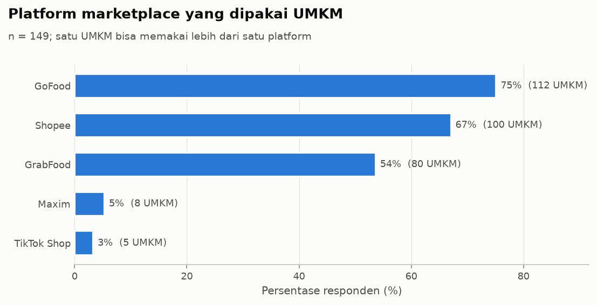
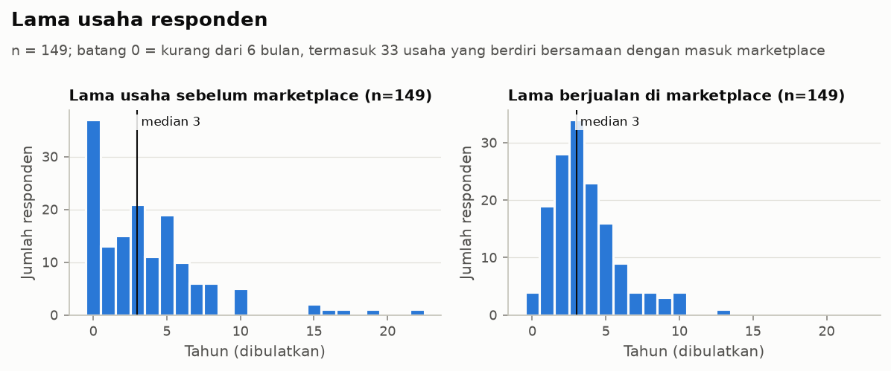
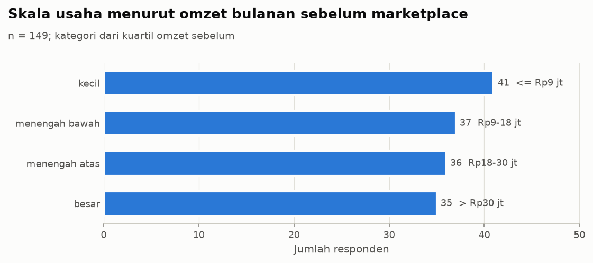
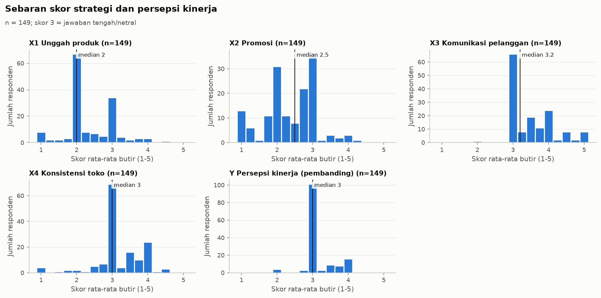
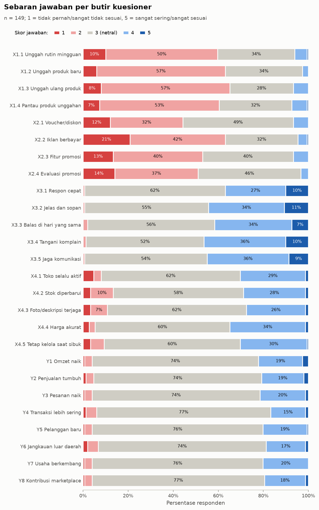
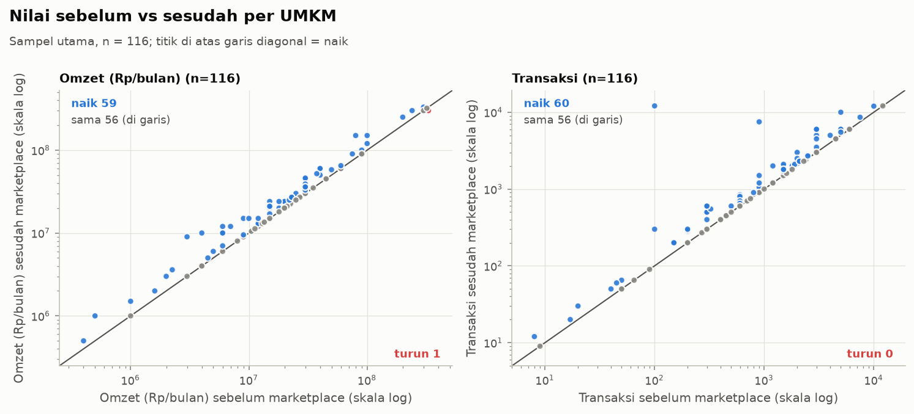
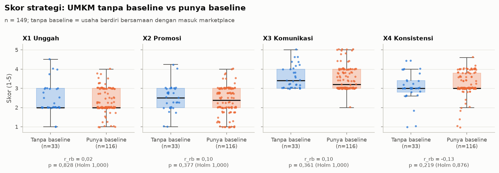

# Log EDA (Tahap 3)

Dibuat oleh `umkm.eda` pada 2026-10-30 09:52.

- Analisis yang menyangkut kinerja memakai **sampel utama** (n = 116, D14); semua 149 responden dilaporkan sebagai pembanding. Profil dan skor strategi memakai 149 responden.
- Uji nonparametrik: Wilcoxon signed-rank (pasangan tanpa beda dibuang), Mann-Whitney U (pendekatan normal dengan koreksi ties), Spearman (CI 95% Fisher-z, SE Bonett-Wright). Koreksi Holm per keluarga uji. Ukuran efek: r = Z/sqrt(N) dan rank-biserial; label Cohen (0,1 kecil; 0,3 sedang; 0,5 besar).
- Semua hasil adalah **asosiasi**, bukan sebab-akibat.
- Tabel lengkap: `reports/tables/eda_*.csv`.

## 1. Profil responden

| platform | n_utama | pct_utama | n_semua_149 | pct_semua_149 |
|---|---|---|---|---|
| GoFood | 86 | 0.74 | 112 | 0.75 |
| Shopee | 78 | 0.67 | 100 | 0.67 |
| GrabFood | 63 | 0.54 | 80 | 0.54 |
| Maxim | 5 | 0.04 | 8 | 0.05 |
| TikTok Shop | 2 | 0.02 | 5 | 0.03 |

Kombinasi platform (5 teratas):

| kombinasi | n | pct |
|---|---|---|
| GoFood + GrabFood + Shopee | 53 | 0.36 |
| GoFood | 25 | 0.17 |
| Shopee | 22 | 0.15 |
| GoFood + Shopee | 15 | 0.10 |
| GoFood + GrabFood | 12 | 0.08 |

**Interpretasi:** GoFood (75%) dan Shopee (67%) paling banyak dipakai dan kombinasi terbanyak adalah GoFood + GrabFood + Shopee (53 UMKM); Maxim dan TikTok Shop hanya dipakai 8 dan 5 UMKM sehingga terlalu sedikit untuk dianalisis sebagai kelompok tersendiri.

| variabel | sampel | count | mean | std | min | 25% | 50% | 75% | max |
|---|---|---|---|---|---|---|---|---|---|
| lama_usaha_pra_mp | utama | 116.00 | 4.74 | 3.83 | 0.08 | 2.00 | 4.00 | 6.00 | 22.00 |
| lama_di_mp | utama | 116.00 | 3.75 | 2.21 | 0.08 | 2.00 | 3.00 | 5.00 | 10.00 |
| jumlah_platform | utama | 116.00 | 2.02 | 0.93 | 1.00 | 1.00 | 2.00 | 3.00 | 4.00 |
| omzet_sebelum_juta | utama | 116.00 | 41.30 | 66.75 | 0.40 | 11.81 | 20.00 | 35.62 | 330.00 |
| lama_usaha_pra_mp | semua_149 | 149.00 | 3.69 | 3.91 | 0.00 | 1.00 | 3.00 | 5.00 | 22.00 |
| lama_di_mp | semua_149 | 149.00 | 3.65 | 2.34 | 0.08 | 2.00 | 3.00 | 5.00 | 13.00 |
| jumlah_platform | semua_149 | 149.00 | 2.05 | 0.94 | 1.00 | 1.00 | 2.00 | 3.00 | 4.00 |
| omzet_sebelum_juta | semua_149 | 149.00 | 38.50 | 65.02 | 0.00 | 9.00 | 18.00 | 30.00 | 330.00 |

**Interpretasi:** Median lama usaha sebelum marketplace 3 tahun dan median lama berjualan di marketplace 3 tahun; 33 UMKM (22%) berdiri bersamaan dengan masuk marketplace sehingga tidak punya kondisi 'sebelum' yang bermakna dan dikeluarkan dari analisis utama (D14).

| skala_omzet | rentang_omzet_sebelum | n_utama | n_semua_149 |
|---|---|---|---|
| Q1_kecil | <= Rp9 jt | 26 | 41 |
| Q2_menengah_bawah | Rp9-18 jt | 30 | 37 |
| Q3_menengah_atas | Rp18-30 jt | 30 | 36 |
| Q4_besar | > Rp30 jt | 30 | 35 |

**Interpretasi:** Keempat kelompok skala usaha berukuran mirip (35-41 UMKM) karena dibentuk dari kuartil; separuh UMKM beromzet sebelum marketplace paling banyak Rp18,0 jt per bulan.

## 2. Distribusi skor konstruk

Efek lantai/atap: > 15% responden di skor 1 atau 5. Dominasi: > 50% responden pada satu nilai skor.

| sampel | konstruk | n | rata_rata | sd | median | skewness | pct_floor | pct_ceiling | nilai_dominan | pct_nilai_dominan | efek_floor | efek_ceiling | dominasi_satu_nilai |
|---|---|---|---|---|---|---|---|---|---|---|---|---|---|
| utama | x1_unggah | 116 | 2.34 | 0.64 | 2.00 | 0.13 | 0.05 | 0.00 | 2.00 | 0.43 | TIDAK | TIDAK | TIDAK |
| utama | x2_promosi | 116 | 2.34 | 0.74 | 2.38 | -0.18 | 0.09 | 0.00 | 3.00 | 0.24 | TIDAK | TIDAK | TIDAK |
| utama | x3_komunikasi | 116 | 3.50 | 0.62 | 3.20 | 0.86 | 0.00 | 0.06 | 3.00 | 0.47 | TIDAK | TIDAK | TIDAK |
| utama | x4_konsistensi | 116 | 3.22 | 0.61 | 3.00 | -0.86 | 0.02 | 0.00 | 3.00 | 0.49 | TIDAK | TIDAK | TIDAK |
| utama | y_persepsi | 116 | 3.18 | 0.44 | 3.00 | 0.48 | 0.00 | 0.00 | 3.00 | 0.66 | TIDAK | TIDAK | ya |
| semua_149 | x1_unggah | 149 | 2.36 | 0.68 | 2.00 | 0.40 | 0.05 | 0.00 | 2.00 | 0.45 | TIDAK | TIDAK | TIDAK |
| semua_149 | x2_promosi | 149 | 2.38 | 0.73 | 2.50 | -0.14 | 0.09 | 0.00 | 3.00 | 0.24 | TIDAK | TIDAK | TIDAK |
| semua_149 | x3_komunikasi | 149 | 3.51 | 0.62 | 3.20 | 0.84 | 0.00 | 0.05 | 3.00 | 0.44 | TIDAK | TIDAK | TIDAK |
| semua_149 | x4_konsistensi | 149 | 3.19 | 0.65 | 3.00 | -0.90 | 0.03 | 0.00 | 3.00 | 0.46 | TIDAK | TIDAK | TIDAK |
| semua_149 | y_persepsi | 149 | 3.16 | 0.47 | 3.00 | 0.23 | 0.00 | 0.00 | 3.00 | 0.67 | TIDAK | TIDAK | ya |

**Interpretasi:** Skor unggah produk (X1) (median 2,00) dan promosi (X2) (median 2,50) tergolong rendah, sedangkan konsistensi kelola toko (X4) (median 3,00) dan komunikasi pelanggan (X3) (median 3,20) berada di sekitar titik tengah; tidak ada efek lantai/atap (> 15% responden di skor 1 atau 5), tetapi skor menumpuk di satu nilai, paling ekstrem pada persepsi kinerja (67% responden tepat 3).

| label | pct_1 | pct_2 | pct_3 | pct_4 | pct_5 | dominasi_netral |
|---|---|---|---|---|---|---|
| X1.1 Unggah rutin mingguan | 0.10 | 0.50 | 0.34 | 0.05 | 0.01 | TIDAK |
| X1.2 Unggah produk baru | 0.06 | 0.57 | 0.34 | 0.03 | 0.00 | TIDAK |
| X1.3 Unggah ulang produk | 0.08 | 0.57 | 0.28 | 0.07 | 0.00 | TIDAK |
| X1.4 Pantau produk unggahan | 0.07 | 0.53 | 0.32 | 0.07 | 0.01 | TIDAK |
| X2.1 Voucher/diskon | 0.12 | 0.32 | 0.49 | 0.07 | 0.00 | TIDAK |
| X2.2 Iklan berbayar | 0.21 | 0.42 | 0.32 | 0.04 | 0.01 | TIDAK |
| X2.3 Fitur promosi | 0.13 | 0.40 | 0.40 | 0.07 | 0.00 | TIDAK |
| X2.4 Evaluasi promosi | 0.14 | 0.37 | 0.46 | 0.03 | 0.00 | TIDAK |
| X3.1 Respon cepat | 0.00 | 0.01 | 0.62 | 0.27 | 0.10 | ya |
| X3.2 Jelas dan sopan | 0.00 | 0.01 | 0.55 | 0.34 | 0.11 | ya |
| X3.3 Balas di hari yang sama | 0.00 | 0.02 | 0.56 | 0.34 | 0.07 | ya |
| X3.4 Tangani komplain | 0.00 | 0.01 | 0.52 | 0.36 | 0.10 | ya |
| X3.5 Jaga komunikasi | 0.00 | 0.01 | 0.54 | 0.36 | 0.09 | ya |
| X4.1 Toko selalu aktif | 0.05 | 0.03 | 0.62 | 0.29 | 0.01 | ya |
| X4.2 Stok diperbarui | 0.03 | 0.10 | 0.58 | 0.28 | 0.01 | ya |
| X4.3 Foto/deskripsi terjaga | 0.03 | 0.07 | 0.62 | 0.26 | 0.01 | ya |
| X4.4 Harga akurat | 0.03 | 0.03 | 0.60 | 0.34 | 0.01 | ya |
| X4.5 Tetap kelola saat sibuk | 0.03 | 0.06 | 0.60 | 0.30 | 0.01 | ya |
| Y1 Omzet naik | 0.01 | 0.03 | 0.74 | 0.19 | 0.03 | ya |
| Y2 Penjualan tumbuh | 0.01 | 0.03 | 0.74 | 0.19 | 0.02 | ya |
| Y3 Pesanan naik | 0.01 | 0.03 | 0.74 | 0.20 | 0.01 | ya |
| Y4 Transaksi lebih sering | 0.01 | 0.05 | 0.77 | 0.15 | 0.01 | ya |
| Y5 Pelanggan baru | 0.01 | 0.03 | 0.76 | 0.19 | 0.01 | ya |
| Y6 Jangkauan luar daerah | 0.02 | 0.05 | 0.74 | 0.17 | 0.01 | ya |
| Y7 Usaha berkembang | 0.01 | 0.03 | 0.76 | 0.20 | 0.00 | ya |
| Y8 Kontribusi marketplace | 0.01 | 0.03 | 0.77 | 0.18 | 0.01 | ya |

**Interpretasi:** Jawaban netral (3) dipilih lebih dari separuh responden pada 18 dari 26 butir, termasuk 8 dari 8 butir persepsi kinerja (74%-77%); sebaliknya butir unggah dan promosi didominasi skor 1-2 (44%-65% responden), terutama iklan berbayar.

## 3. Sebelum vs sesudah (nilai terwinsor)

| sampel | variabel | n_pasangan | n_naik | n_sama | n_turun | median_sebelum | median_sesudah | median_selisih | z | p | r | r_semua_pasangan | r_rank_biserial | efek |
|---|---|---|---|---|---|---|---|---|---|---|---|---|---|---|
| utama | omzet (Rp) | 116 | 59 | 56 | 1 | 2e+07 | 2.18e+07 | 2.5e+05 | 6.33 | 2.41e-10 | 0.818 | 0.588 | 0.939 | besar |
| utama | transaksi | 116 | 60 | 56 | 0 | 900 | 1.02e+03 | 7 | 6.74 | 1.55e-11 | 0.871 | 0.626 | 1 | besar |
| semua_149 | omzet (Rp) | 149 | 61 | 87 | 1 | 1.8e+07 | 2e+07 | 0 | 6.46 | 1.08e-10 | 0.82 | 0.529 | 0.942 | besar |
| semua_149 | transaksi | 149 | 64 | 85 | 0 | 900 | 900 | 0 | 6.96 | 3.37e-12 | 0.87 | 0.57 | 1 | besar |

Catatan: Wilcoxon membuang pasangan tanpa beda, sehingga r dihitung dari UMKM yang berubah saja; `r_semua_pasangan` (pembagi = semua pasangan) lebih konservatif. Transaksi tidak punya satu pun penurunan, jadi rank-biserial = 1. Perbandingan sebelum-sesudah ini tidak punya kelompok pembanding, sehingga tidak dapat dipakai untuk menyimpulkan bahwa kenaikan disebabkan oleh marketplace.

**Interpretasi:** Di sampel utama, 51% UMKM mencatat omzet naik dan 52% transaksi naik, hampir separuh tidak berubah, dan penurunan jarang (omzet 1 UMKM, transaksi 0); bila 33 UMKM tanpa baseline ikut dihitung, porsi 'sama' membesar karena mereka umumnya mengisi angka sebelum = sesudah.

**Interpretasi:** Hampir semua titik berada pada atau sedikit di atas garis diagonal: perubahan umumnya kecil (median selisih omzet Rp250 ribu, transaksi 7,0), tetapi di antara UMKM yang berubah, arahnya hampir selalu naik (Wilcoxon: omzet r = 0,82, transaksi r = 0,87, keduanya p < 0,001); titik merah di bawah garis adalah 1 UMKM yang omzetnya turun.

## 4. Korelasi Spearman strategi vs kinerja

| sampel | x | y | n | rho | ci_bawah | ci_atas | p | p_holm |
|---|---|---|---|---|---|---|---|---|
| utama | x1_unggah | d_omzet | 116 | 0.236 | 0.054 | 0.403 | 0.011 | 0.097 |
| utama | x1_unggah | d_trx | 116 | 0.249 | 0.067 | 0.415 | 0.007 | 0.071 |
| utama | x1_unggah | y_obj | 116 | 0.256 | 0.075 | 0.422 | 0.005 | 0.060 |
| utama | x1_unggah | y_pelanggan_baru | 116 | 0.060 | -0.123 | 0.240 | 0.519 | 0.767 |
| utama | x2_promosi | d_omzet | 116 | 0.350 | 0.173 | 0.504 | 0.000 | 0.002 |
| utama | x2_promosi | d_trx | 116 | 0.282 | 0.102 | 0.445 | 0.002 | 0.028 |
| utama | x2_promosi | y_obj | 116 | 0.319 | 0.141 | 0.478 | 0.000 | 0.007 |
| utama | x2_promosi | y_pelanggan_baru | 116 | 0.130 | -0.054 | 0.306 | 0.164 | 0.676 |
| utama | x3_komunikasi | d_omzet | 116 | 0.222 | 0.039 | 0.390 | 0.017 | 0.134 |
| utama | x3_komunikasi | d_trx | 116 | 0.301 | 0.121 | 0.461 | 0.001 | 0.015 |
| utama | x3_komunikasi | y_obj | 116 | 0.280 | 0.099 | 0.443 | 0.002 | 0.028 |
| utama | x3_komunikasi | y_pelanggan_baru | 116 | -0.197 | -0.367 | -0.013 | 0.034 | 0.241 |
| utama | x4_konsistensi | d_omzet | 116 | 0.082 | -0.102 | 0.260 | 0.383 | 0.767 |
| utama | x4_konsistensi | d_trx | 116 | 0.178 | -0.006 | 0.350 | 0.056 | 0.335 |
| utama | x4_konsistensi | y_obj | 116 | 0.140 | -0.045 | 0.315 | 0.135 | 0.676 |
| utama | x4_konsistensi | y_pelanggan_baru | 116 | 0.113 | -0.071 | 0.290 | 0.226 | 0.678 |
| semua_149 | x1_unggah | d_omzet | 149 | 0.207 | 0.046 | 0.358 | 0.011 | 0.123 |
| semua_149 | x1_unggah | d_trx | 149 | 0.234 | 0.074 | 0.383 | 0.004 | 0.052 |
| semua_149 | x1_unggah | y_obj | 149 | 0.246 | 0.087 | 0.394 | 0.002 | 0.034 |
| semua_149 | x1_unggah | y_pelanggan_baru | 149 | 0.106 | -0.056 | 0.263 | 0.198 | 0.581 |
| semua_149 | x2_promosi | d_omzet | 149 | 0.279 | 0.121 | 0.424 | 0.001 | 0.009 |
| semua_149 | x2_promosi | d_trx | 149 | 0.227 | 0.067 | 0.376 | 0.005 | 0.064 |
| semua_149 | x2_promosi | y_obj | 149 | 0.256 | 0.097 | 0.403 | 0.002 | 0.024 |
| semua_149 | x2_promosi | y_pelanggan_baru | 149 | 0.162 | 0.000 | 0.316 | 0.048 | 0.290 |
| semua_149 | x3_komunikasi | d_omzet | 149 | 0.162 | -0.000 | 0.315 | 0.049 | 0.290 |
| semua_149 | x3_komunikasi | d_trx | 149 | 0.205 | 0.044 | 0.356 | 0.012 | 0.123 |
| semua_149 | x3_komunikasi | y_obj | 149 | 0.185 | 0.024 | 0.337 | 0.024 | 0.189 |
| semua_149 | x3_komunikasi | y_pelanggan_baru | 149 | -0.094 | -0.251 | 0.068 | 0.253 | 0.581 |
| semua_149 | x4_konsistensi | d_omzet | 149 | 0.107 | -0.055 | 0.264 | 0.194 | 0.581 |
| semua_149 | x4_konsistensi | d_trx | 149 | 0.199 | 0.037 | 0.350 | 0.015 | 0.137 |
| semua_149 | x4_konsistensi | y_obj | 149 | 0.175 | 0.014 | 0.328 | 0.033 | 0.229 |
| semua_149 | x4_konsistensi | y_pelanggan_baru | 149 | 0.125 | -0.037 | 0.281 | 0.128 | 0.513 |

**Interpretasi:** Promosi (X2) dan komunikasi pelanggan (X3) berkorelasi positif lemah-sedang dengan kinerja gabungan Y_obj (rho 0,28-0,32, Holm p < 0,05), sedangkan unggah produk (X1) dan konsistensi kelola toko (X4) paling lemah (rho 0,14-0,26, tidak bermakna); tidak satu pun strategi berkorelasi positif bermakna dengan jumlah pelanggan baru.

### Persepsi sebagai pembanding

| sampel | x | y | n | rho | ci_bawah | ci_atas | p | p_holm | jenis |
|---|---|---|---|---|---|---|---|---|---|
| utama | y_persepsi | d_omzet | 116 | 0.182 | -0.002 | 0.354 | 0.050 | 0.301 | persepsi_vs_angka |
| utama | y_persepsi | d_trx | 116 | 0.280 | 0.099 | 0.443 | 0.002 | 0.019 | persepsi_vs_angka |
| utama | y_persepsi | y_obj | 116 | 0.247 | 0.065 | 0.413 | 0.008 | 0.053 | persepsi_vs_angka |
| utama | y_persepsi | y_pelanggan_baru | 116 | -0.053 | -0.233 | 0.131 | 0.571 | 1.000 | persepsi_vs_angka |
| utama | y_persepsi_1 | d_omzet | 116 | 0.182 | -0.002 | 0.354 | 0.051 | 0.301 | butir_vs_padanan |
| utama | y_persepsi_4 | d_trx | 116 | 0.178 | -0.006 | 0.350 | 0.056 | 0.301 | butir_vs_padanan |
| utama | y_persepsi_5 | y_pelanggan_baru | 116 | -0.025 | -0.207 | 0.158 | 0.789 | 1.000 | butir_vs_padanan |
| utama | y_persepsi | x1_unggah | 116 | 0.297 | 0.117 | 0.458 | 0.001 | 0.011 | persepsi_vs_strategi |
| utama | y_persepsi | x2_promosi | 116 | 0.129 | -0.055 | 0.305 | 0.167 | 0.501 | persepsi_vs_strategi |
| utama | y_persepsi | x3_komunikasi | 116 | 0.375 | 0.200 | 0.526 | 0.000 | 0.000 | persepsi_vs_strategi |
| utama | y_persepsi | x4_konsistensi | 116 | 0.374 | 0.199 | 0.525 | 0.000 | 0.000 | persepsi_vs_strategi |
| semua_149 | y_persepsi | d_omzet | 149 | 0.158 | -0.004 | 0.312 | 0.054 | 0.272 | persepsi_vs_angka |
| semua_149 | y_persepsi | d_trx | 149 | 0.207 | 0.046 | 0.357 | 0.011 | 0.092 | persepsi_vs_angka |
| semua_149 | y_persepsi | y_obj | 149 | 0.193 | 0.032 | 0.344 | 0.018 | 0.129 | persepsi_vs_angka |
| semua_149 | y_persepsi | y_pelanggan_baru | 149 | -0.008 | -0.169 | 0.153 | 0.923 | 1.000 | persepsi_vs_angka |
| semua_149 | y_persepsi_1 | d_omzet | 149 | 0.147 | -0.015 | 0.301 | 0.074 | 0.294 | butir_vs_padanan |
| semua_149 | y_persepsi_4 | d_trx | 149 | 0.143 | -0.019 | 0.297 | 0.083 | 0.294 | butir_vs_padanan |
| semua_149 | y_persepsi_5 | y_pelanggan_baru | 149 | 0.033 | -0.129 | 0.193 | 0.692 | 1.000 | butir_vs_padanan |
| semua_149 | y_persepsi | x1_unggah | 149 | 0.352 | 0.198 | 0.489 | 0.000 | 0.000 | persepsi_vs_strategi |
| semua_149 | y_persepsi | x2_promosi | 149 | 0.181 | 0.019 | 0.333 | 0.027 | 0.165 | persepsi_vs_strategi |
| semua_149 | y_persepsi | x3_komunikasi | 149 | 0.266 | 0.107 | 0.412 | 0.001 | 0.009 | persepsi_vs_strategi |
| semua_149 | y_persepsi | x4_konsistensi | 149 | 0.379 | 0.227 | 0.513 | 0.000 | 0.000 | persepsi_vs_strategi |

`persepsi_vs_angka`: apakah persepsi selaras dengan angka nyata; `butir_vs_padanan`: butir persepsi vs ukuran objektif padanannya; `persepsi_vs_strategi`: persepsi vs skor strategi.

## 5. Perbandingan kelompok (Mann-Whitney U)

### naik_penjualan = 1 vs 0

Holm dihitung per varian atas 4 strategi; baris y_persepsi diuji terpisah (pembanding). `utama_tanpa_seragam` = sampel utama tanpa `flag_jawaban_seragam` (D20).

| varian | variabel | n_1 | n_0 | median_1 | median_0 | z | p | p_holm | r | r_rank_biserial | efek |
|---|---|---|---|---|---|---|---|---|---|---|---|
| utama | x1_unggah | 62 | 54 | 2.250 | 2.000 | 2.903 | 0.004 | 0.011 | 0.270 | 0.298 | kecil |
| utama | x2_promosi | 62 | 54 | 2.750 | 2.000 | 2.838 | 0.005 | 0.011 | 0.264 | 0.302 | kecil |
| utama | x3_komunikasi | 62 | 54 | 3.700 | 3.000 | 3.295 | 0.001 | 0.004 | 0.306 | 0.335 | sedang |
| utama | x4_konsistensi | 62 | 54 | 3.000 | 3.000 | 1.331 | 0.183 | 0.183 | 0.124 | 0.135 | kecil |
| utama | y_persepsi | 62 | 54 | 3.000 | 3.000 | 2.647 | 0.008 | 0.008 | 0.246 | 0.242 | kecil |
| utama_tanpa_seragam | x1_unggah | 54 | 53 | 2.000 | 2.000 | 2.162 | 0.031 | 0.091 | 0.209 | 0.229 | kecil |
| utama_tanpa_seragam | x2_promosi | 54 | 53 | 2.500 | 2.000 | 2.164 | 0.030 | 0.091 | 0.209 | 0.240 | kecil |
| utama_tanpa_seragam | x3_komunikasi | 54 | 53 | 3.900 | 3.000 | 3.873 | 0.000 | 0.000 | 0.374 | 0.414 | sedang |
| utama_tanpa_seragam | x4_konsistensi | 54 | 53 | 3.000 | 3.000 | 1.536 | 0.125 | 0.125 | 0.148 | 0.164 | kecil |
| utama_tanpa_seragam | y_persepsi | 54 | 53 | 3.000 | 3.000 | 2.815 | 0.005 | 0.005 | 0.272 | 0.272 | kecil |
| semua_149 | x1_unggah | 66 | 83 | 2.375 | 2.000 | 2.982 | 0.003 | 0.011 | 0.244 | 0.270 | kecil |
| semua_149 | x2_promosi | 66 | 83 | 2.750 | 2.250 | 2.430 | 0.015 | 0.045 | 0.199 | 0.229 | kecil |
| semua_149 | x3_komunikasi | 66 | 83 | 3.600 | 3.200 | 2.381 | 0.017 | 0.045 | 0.195 | 0.217 | kecil |
| semua_149 | x4_konsistensi | 66 | 83 | 3.000 | 3.000 | 1.894 | 0.058 | 0.058 | 0.155 | 0.171 | kecil |
| semua_149 | y_persepsi | 66 | 83 | 3.000 | 3.000 | 2.333 | 0.020 | 0.020 | 0.191 | 0.186 | kecil |

**Interpretasi:** UMKM yang penjualannya naik cenderung memiliki skor komunikasi pelanggan (X3), promosi (X2) dan unggah produk (X1) lebih tinggi (rank-biserial 0,30-0,34, efek kecil-sedang, Holm p < 0,05), sedangkan skor konsistensi kelola toko (X4) tidak berbeda nyata antara kedua kelompok.

### tanpa_baseline (1) vs punya baseline (0), 149 responden

| varian | variabel | n_1 | n_0 | median_1 | median_0 | z | p | p_holm | r | r_rank_biserial | efek |
|---|---|---|---|---|---|---|---|---|---|---|---|
| strategi | x1_unggah | 33 | 116 | 2.000 | 2.000 | 0.217 | 0.828 | 1.000 | 0.018 | 0.024 | sangat kecil |
| strategi | x2_promosi | 33 | 116 | 2.500 | 2.375 | 0.883 | 0.377 | 1.000 | 0.072 | 0.100 | sangat kecil |
| strategi | x3_komunikasi | 33 | 116 | 3.400 | 3.200 | 0.914 | 0.361 | 1.000 | 0.075 | 0.100 | sangat kecil |
| strategi | x4_konsistensi | 33 | 116 | 3.000 | 3.000 | -1.229 | 0.219 | 0.876 | -0.101 | -0.133 | kecil |
| profil_dan_lainnya | y_persepsi | 33 | 116 | 3.000 | 3.000 | -1.129 | 0.259 | 0.518 | -0.092 | -0.108 | sangat kecil |
| profil_dan_lainnya | lama_di_mp | 33 | 116 | 3.000 | 3.000 | -1.670 | 0.095 | 0.285 | -0.137 | -0.189 | kecil |
| profil_dan_lainnya | jumlah_platform | 33 | 116 | 2.000 | 2.000 | 0.738 | 0.460 | 0.518 | 0.060 | 0.080 | sangat kecil |
| profil_dan_lainnya | log_omzet_sebelum | 33 | 116 | 16.118 | 16.811 | -2.181 | 0.029 | 0.146 | -0.179 | -0.249 | kecil |
| profil_dan_lainnya | y_pelanggan_baru | 33 | 116 | 4.615 | 3.932 | 2.053 | 0.040 | 0.160 | 0.168 | 0.234 | kecil |

**Interpretasi:** Skor keempat strategi UMKM tanpa baseline tidak berbeda nyata dari UMKM lainnya (semua Holm p > 0,05, rank-biserial -0,13 sampai 0,10), sehingga mengeluarkan mereka dari analisis utama kecil kemungkinannya menggeser gambaran strategi sampel.

## 6. VIF

Batas waspada VIF > 5. VIF maksimum: semua_149 / A_strategi = 1,44; semua_149 / B_strategi_profil = 1,50; semua_149 / C_strategi_profil_dummy_platform = 1,57; utama / A_strategi = 1,31; utama / B_strategi_profil = 1,37; utama / C_strategi_profil_dummy_platform = 1,48. `jumlah_platform` dan dummy platform tidak dimasukkan bersamaan (kolinear sempurna).

| sampel | set | variabel | vif | waspada |
|---|---|---|---|---|
| utama | A_strategi | x1_unggah | 1.26 | TIDAK |
| utama | A_strategi | x2_promosi | 1.22 | TIDAK |
| utama | A_strategi | x3_komunikasi | 1.25 | TIDAK |
| utama | A_strategi | x4_konsistensi | 1.31 | TIDAK |
| utama | B_strategi_profil | x1_unggah | 1.29 | TIDAK |
| utama | B_strategi_profil | x2_promosi | 1.29 | TIDAK |
| utama | B_strategi_profil | x3_komunikasi | 1.31 | TIDAK |
| utama | B_strategi_profil | x4_konsistensi | 1.35 | TIDAK |
| utama | B_strategi_profil | lama_usaha_pra_mp | 1.32 | TIDAK |
| utama | B_strategi_profil | lama_di_mp | 1.37 | TIDAK |
| utama | B_strategi_profil | jumlah_platform | 1.06 | TIDAK |
| utama | B_strategi_profil | log_omzet_sebelum | 1.05 | TIDAK |
| utama | C_strategi_profil_dummy_platform | x1_unggah | 1.44 | TIDAK |
| utama | C_strategi_profil_dummy_platform | x2_promosi | 1.31 | TIDAK |
| utama | C_strategi_profil_dummy_platform | x3_komunikasi | 1.43 | TIDAK |
| utama | C_strategi_profil_dummy_platform | x4_konsistensi | 1.41 | TIDAK |
| utama | C_strategi_profil_dummy_platform | lama_usaha_pra_mp | 1.48 | TIDAK |
| utama | C_strategi_profil_dummy_platform | lama_di_mp | 1.38 | TIDAK |
| utama | C_strategi_profil_dummy_platform | log_omzet_sebelum | 1.06 | TIDAK |
| utama | C_strategi_profil_dummy_platform | mp_gofood | 1.26 | TIDAK |
| utama | C_strategi_profil_dummy_platform | mp_grabfood | 1.25 | TIDAK |
| utama | C_strategi_profil_dummy_platform | mp_shopee | 1.29 | TIDAK |
| utama | C_strategi_profil_dummy_platform | mp_maxim | 1.14 | TIDAK |
| utama | C_strategi_profil_dummy_platform | mp_tiktok | 1.16 | TIDAK |
