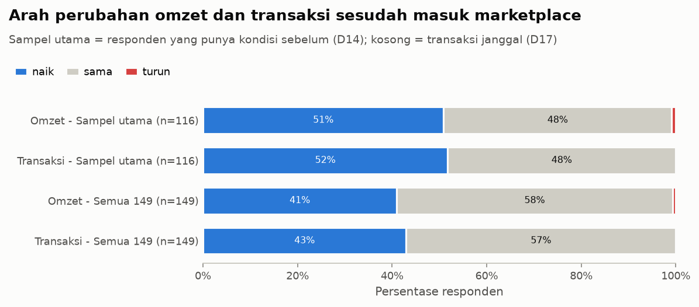
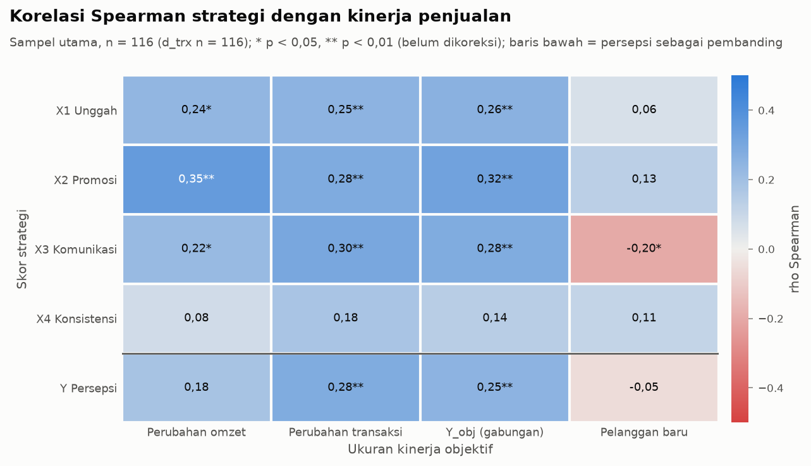
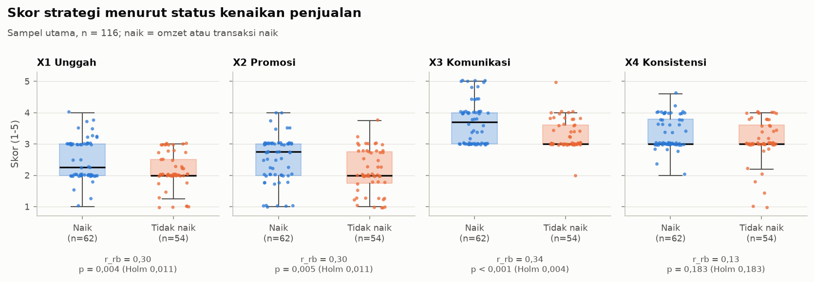

# Hasil Utama Proyek: Strategi Marketplace dan Kinerja Penjualan UMKM

Status per 14 Oktober 2026: Tahap 1–2 selesai, Tahap 3 (EDA) menunggu persetujuan, Tahap 4–7 belum dikerjakan.
Semua hasil menggambarkan **keterkaitan (asosiasi)**, bukan sebab-akibat.

---

## 1. Alur pengerjaan

```
 Kuesioner Google Form (149 UMKM)
            │
            ▼
 [Tahap 1] CLEANING ─────────── SELESAI
            │  data/raw/…xlsx  →  data/processed/data_clean.csv
            ▼
 [Tahap 2] KONSTRUKSI VARIABEL ─ SELESAI
            │  data_clean.csv  →  data/processed/data_features.csv
            ▼
 [Tahap 3] EDA (eksplorasi) ──── MENUNGGU PERSETUJUAN
            │  data_features.csv → 12 tabel + 10 grafik + ringkasan
            ▼
 [Tahap 4] Analisis pengaruh (regresi, Random Forest, SHAP)   ← belum
 [Tahap 5] Segmentasi UMKM (K-Means)                          ← belum
 [Tahap 6] Rekomendasi per segmen                             ← belum
 [Tahap 7] Laporan akhir                                      ← belum
```

Menjalankan ulang semua tahap: `python -m umkm.pipeline --all`

---

## 2. Apa yang dikerjakan dan data apa yang dihasilkan

### Tahap 1 – Cleaning (merapikan data mentah)

| | |
|---|---|
| **Masukan** | `data/raw/Kuesioner_Penelitian__Responses_.xlsx` (149 baris × 37 kolom; tidak pernah diubah) |
| **Keluaran** | `data/processed/data_clean.csv` (149 × 64 kolom), log: `reports/cleaning_log.md` |

Yang dikerjakan:
- Nama kolom dirapikan (`x1_unggah_1`, `omzet_sebelum`, …); jawaban Likert seperti "3. Netral" diubah menjadi angka 3.
- Omzet berformat teks ("3.500.000") diubah menjadi angka; lama usaha "3 bulan" → 0,25 tahun, tahun kalender "2018" → 8 tahun.
- Platform dipecah menjadi kolom ya/tidak (GoFood, GrabFood, Shopee, Maxim, TikTok Shop).
- Nilai ekstrem dipangkas di persentil 99 (winsorizing); transaksi janggal milik 4 responden diganti dengan jumlah pesanan hasil konfirmasi ulang (D25).
- Nama usaha diganti ID R001–R149 di semua laporan.

### Tahap 2 – Konstruksi variabel (membuat skor dan target)

| | |
|---|---|
| **Masukan** | `data_clean.csv` |
| **Keluaran** | `data/processed/data_features.csv` (149 × 58 kolom) — **data siap analisis**; log: `reports/features_log.md` |

Yang dikerjakan:
- **Skor strategi** = rata-rata butir (skala 1–5): X1 Unggah produk, X2 Promosi, X3 Komunikasi pelanggan, X4 Konsistensi toko.
- **Target kinerja** (hanya dari angka nyata, bukan persepsi):
  - `naik_penjualan` = 1 jika omzet atau transaksi naik;
  - `y_obj` = skor gabungan besarnya perubahan omzet dan transaksi;
  - `y_pelanggan_baru` = target tambahan.
- **Sampel utama = 116 UMKM.** 33 UMKM yang berdiri bersamaan dengan masuk marketplace dikeluarkan dari analisis
  utama karena tidak punya kondisi "sebelum" yang bermakna (tetap dipakai sebagai pembanding).
- Penanda kualitas jawaban: 10 responden menjawab semua butir strategi dengan angka sama. Omzet 3 responden yang
  semula tampak turun tajam (R065, R130, R106) sudah dikoreksi lewat konfirmasi ulang ke responden (D25).

**Reliabilitas skor strategi (Cronbach's alpha, batas ≥ 0,70):**

| Strategi | Jumlah butir | Alpha |
|---|---|---|
| X1 Unggah produk | 4 | 0,955 |
| X2 Promosi | 4 | 0,930 |
| X3 Komunikasi pelanggan | 5 | 0,947 |
| X4 Konsistensi toko | 5 | 0,952 |

### Tahap 3 – EDA (melihat pola awal)

| | |
|---|---|
| **Masukan** | `data_features.csv`, `data_clean.csv` |
| **Keluaran** | `reports/eda_ringkasan.md` (bahasa awam), `reports/eda_log.md` (teknis), `reports/figures/eda_*.png` (10 grafik), `reports/tables/eda_*.csv` (12 tabel) |

---

## 3. Hasil utama

### 3.1 Profil responden (149 UMKM)

| Aspek | Hasil |
|---|---|
| Platform terbanyak | GoFood 75%, Shopee 67%, GrabFood 54% (Maxim 5%, TikTok Shop 3%) |
| Kombinasi terbanyak | GoFood + GrabFood + Shopee (53 UMKM) |
| Rata-rata jumlah platform | 2,0 |
| Median omzet sebelum marketplace | Rp18 juta per bulan |
| Median lama berjualan di marketplace | 3 tahun |

### 3.2 Kinerja sebelum vs sesudah marketplace (sampel utama, n = 116)

| Ukuran | Naik | Sama | Turun |
|---|---|---|---|
| Omzet | 59 (51%) | 56 (48%) | 1 (1%) |
| Transaksi | 60 (52%) | 56 (48%) | 0 |
| **Omzet atau transaksi naik** | **62 (53%)** | | |

- Kenaikannya umumnya kecil: median selisih omzet Rp250 ribu per bulan.
- Di antara UMKM yang berubah, arahnya hampir selalu naik (uji Wilcoxon, p < 0,001).
- Tidak ada kelompok pembanding yang tidak memakai marketplace, jadi angka ini **tidak membuktikan** bahwa
  marketplace penyebab kenaikan.



### 3.3 Praktik strategi UMKM (skala 1–5)

| Strategi | Rata-rata | Gambaran |
|---|---|---|
| X1 Unggah produk | 2,36 | Jarang |
| X2 Promosi | 2,38 | Jarang, terutama iklan berbayar |
| X3 Komunikasi pelanggan | 3,51 | Cukup baik |
| X4 Konsistensi toko | 3,19 | Sedang |

### 3.4 Strategi yang berhubungan dengan kenaikan penjualan (inti temuan sementara)

| Strategi | Korelasi dengan kinerja gabungan (rho) | Beda skor UMKM naik vs tidak naik | Kesimpulan |
|---|---|---|---|
| **X2 Promosi** | **0,32** ✔ | lebih tinggi pada yang naik ✔ | Hubungan paling kuat |
| **X3 Komunikasi pelanggan** | **0,28** ✔ | lebih tinggi pada yang naik ✔ | Kuat, dan menguat setelah responden "jawaban seragam" dikeluarkan |
| X1 Unggah produk | 0,26 | lebih tinggi pada yang naik ✔ | **Rapuh**: korelasi tidak bermakna (Holm p 0,060), beda naik vs tidak hilang tanpa responden "jawaban seragam" (lihat 3.6) |
| X4 Konsistensi toko | 0,14 | tidak berbeda | Paling lemah, belum bermakna |

✔ = bermakna secara statistik setelah koreksi uji berganda (Holm, p < 0,05). Kekuatan hubungan: lemah–sedang.





### 3.5 Pelanggan baru dan persepsi kinerja

- **Pelanggan baru** tidak berhubungan bermakna dengan strategi mana pun (rho −0,20 sampai 0,13). Kemungkinan karena
  pertanyaannya ambigu (tidak jelas sebelum atau sesudah marketplace).
- **Persepsi kinerja** (jawaban Likert "omzet saya naik", dll.) hanya lemah selaras dengan angka nyata (rho maksimum
  0,27). Persepsi lebih dekat dengan skor strategi (rho 0,37). Ini mendukung keputusan memakai angka objektif sebagai
  ukuran kinerja.

### 3.6 Catatan kualitas data

| Temuan | Dampak |
|---|---|
| Jawaban netral (3) mendominasi 18 dari 26 butir; skor persepsi 67% responden tepat 3 | Variasi sempit, perbedaan antar-UMKM lebih sulit terdeteksi; masuk bagian keterbatasan |
| 9 responden sampel utama menjawab semua butir strategi dengan angka sama (8 di antaranya naik) | Tanpa mereka, beda skor X1 dan X2 antara UMKM naik vs tidak naik tidak lagi bermakna (Holm p 0,091); X3 justru menguat |
| Omzet R065 dan R130 turun tepat 10 kali lipat, R106 kurang satu nol | Dikonfirmasi ke responden dan dikoreksi (D25); korelasi X1 dengan kinerja gabungan melemah dan tidak lagi bermakna |
| Transaksi R002, R006, R015, R021 tidak masuk akal | Diganti jumlah pesanan hasil konfirmasi kedua (D25). R021 (Ampera Medan) naik 150 kali (100 → 15.000) dan menjadi nilai kinerja gabungan tertinggi; Tahap 4 menguji hasil dengan dan tanpa R021 |
| Tumpang-tindih antar-variabel rendah (VIF maks 1,57) | Keempat strategi aman dimasukkan bersama ke model regresi |
| Skor strategi UMKM tanpa baseline tidak berbeda dari UMKM lain | Mengeluarkan mereka dari analisis utama tidak menggeser gambaran strategi |

---

## 4. Yang perlu diputuskan atau ditanyakan

**Sebelum lanjut ke Tahap 4:**
1. Persetujuan Tahap 3 (EDA).
2. Persetujuan D23: aturan teknis uji di EDA (standar statistik).

**Sebaiknya dikonfirmasi ke lapangan/dosen:**
3. ~~R065 dan R130: apakah omzet yang turun 10 kali lipat memang salah ketik?~~ Terjawab 2026-10-27 (D25).
4. "Pelanggan baru per bulan": yang dimaksud sebelum atau sesudah marketplace?
5. Butir X1.2 dan X2.1 tercantum di instrumen tetapi tidak ada di Excel: memang tidak ditanyakan di form?
6. Dominasi jawaban netral: cukup dibahas sebagai keterbatasan?
7. SEM/PLS-SEM (D08): wajib atau tidak? Jika tidak, cukup regresi + Random Forest.

---

## 5. Peta folder

| Folder/berkas | Isi |
|---|---|
| `data/raw/` | Excel asli (tidak diubah; berisi nama usaha, jangan dibagikan) |
| `data/processed/` | `data_clean.csv` (Tahap 1), `data_features.csv` (Tahap 2) |
| `reports/` | Log tiap tahap, ringkasan, berkas ini; `tables/` dan `figures/` |
| `src/umkm/` | Seluruh kode analisis |
| `notebooks/` | `03_eda.ipynb` (lokal), `00_setup_colab.ipynb` (Google Colab) |
| `tests/` | 58 tes otomatis (semua lolos) |
| `.claude/` | Rencana tiap tahap, log keputusan (`decisions.md`), progres (`progress.md`) |
| `umkm_proyek.zip` | Paket untuk Google Colab (berisi data mentah, jangan dibagikan publik) |
