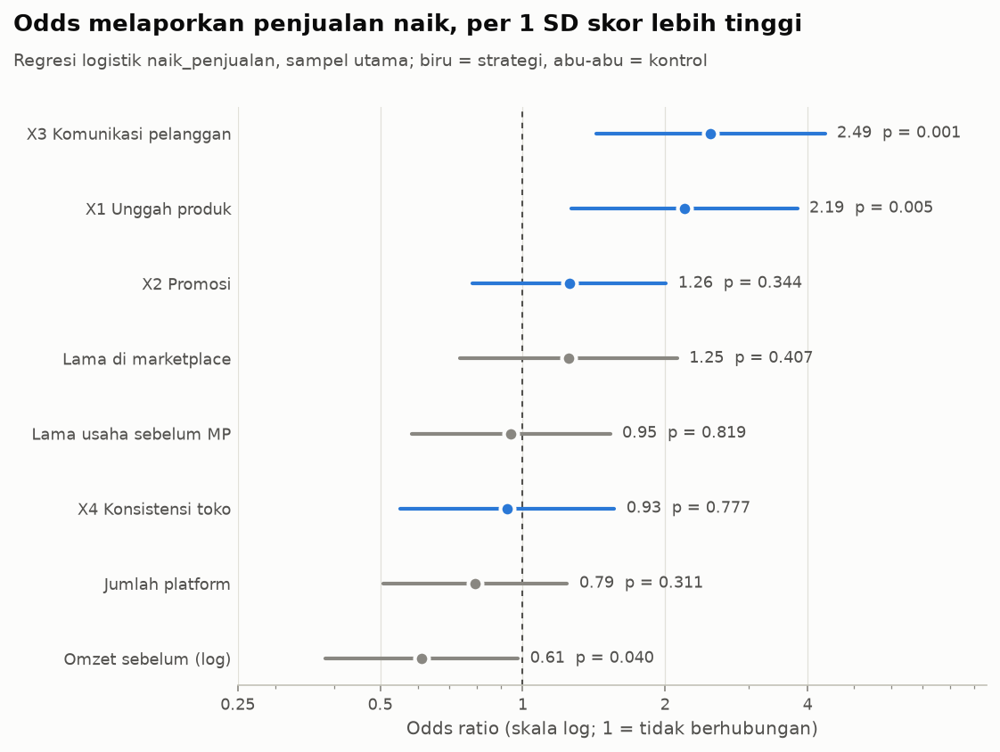
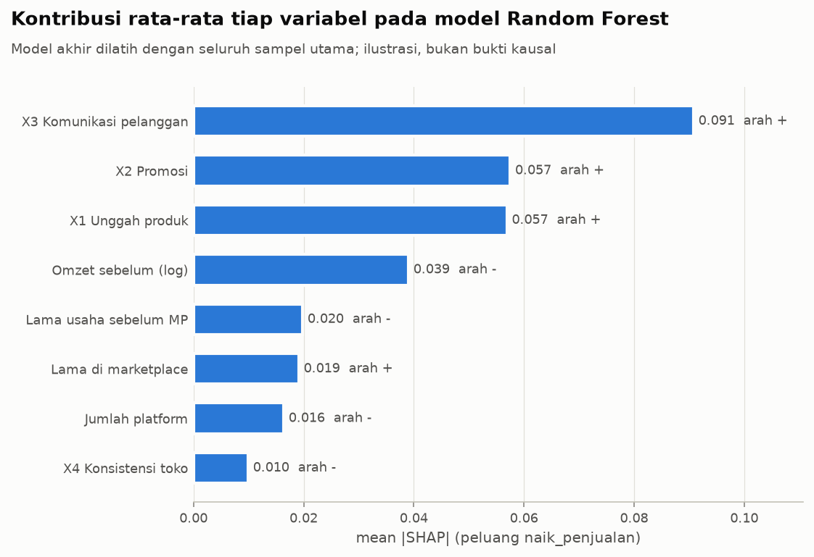
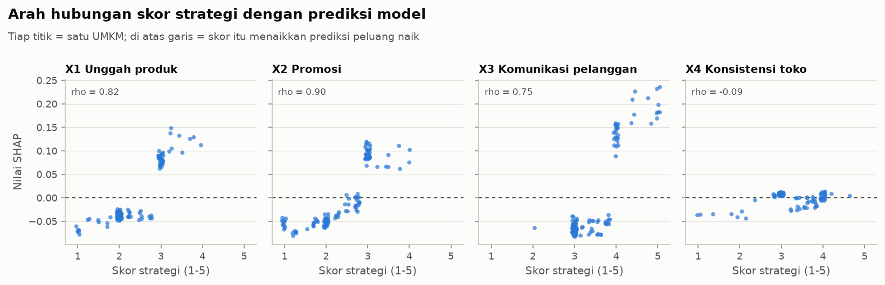
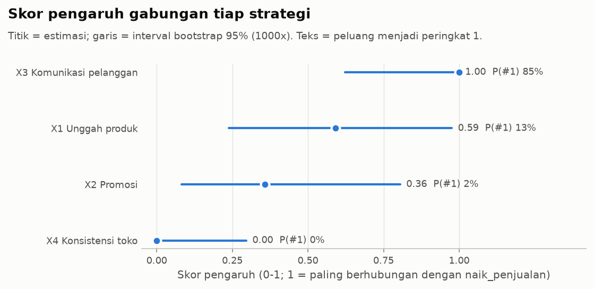
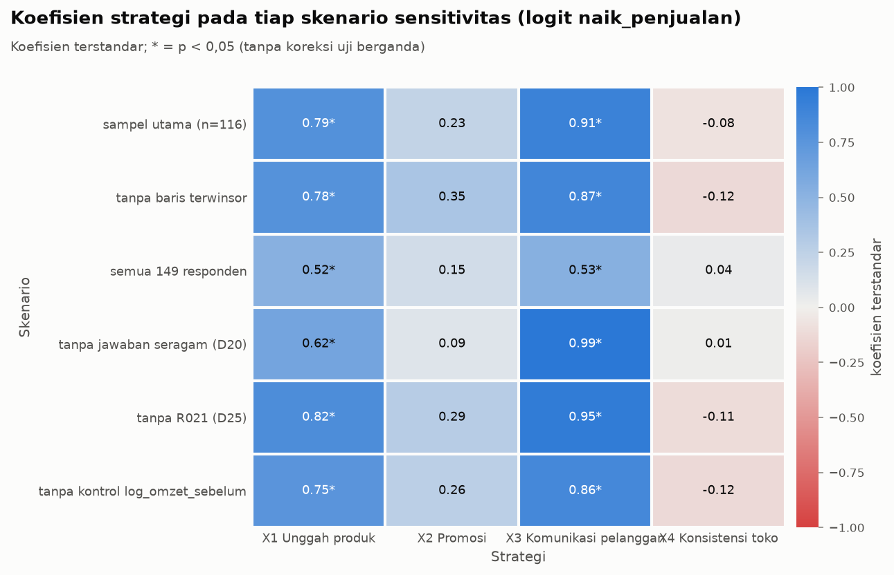
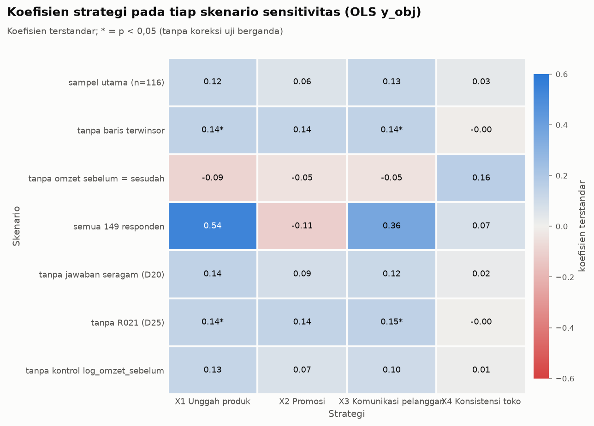

# Log Analisis Pengaruh (Tahap 4)

Dibuat oleh `umkm.pengaruh` pada 2026-10-30 11:03.

## Rancangan

- Sampel utama n = 116 (62 naik_penjualan = 1). Prediktor: 4 skor strategi + kontrol `lama_usaha_pra_mp`, `lama_di_mp`, `jumlah_platform`, `log_omzet_sebelum`, semua distandarkan (koefisien per 1 SD).
- Dari 116 UMKM sampel utama, 62 melaporkan omzet atau transaksi naik (`naik_penjualan` = 1). 54 dari 54 UMKM sisanya menulis omzet DAN transaksi yang sama persis sebelum dan sesudah; tidak ada yang melaporkan keduanya turun. Jadi yang dibandingkan di sini adalah UMKM yang **melaporkan kenaikan** dengan UMKM yang **melaporkan angka sama**, bukan UMKM yang naik dengan yang turun. R015 dihitung naik karena transaksinya naik walau omzetnya turun (definisi D13).
- Target `naik_penjualan` (logit + Random Forest) menjadi dasar bobot rekomendasi; `y_obj` dilaporkan lewat OLS HC3 dan CV regresi (D26).
- CV: 5 lipatan x 5 ulangan, seed 42; Random Forest {'n_estimators': 400, 'max_depth': 4, 'min_samples_leaf': 4}. Bootstrap 1000 iterasi berhasil dari 1000. VIF maksimum model 1,37.

## 1. Regresi logistik `naik_penjualan` (target utama)

n = 116, pseudo R2 McFadden = 0,210. Uji likelihood-ratio blok 4 strategi di atas kontrol: LR = 27,62, df = 4, p < 0,001 (pseudo R2 0,038 -> 0,210). `p_holm` = koreksi Holm atas 4 strategi. `peluang_*` = peluang prediksi pada skor 1 SD di bawah/di atas rata-rata, variabel lain di rata-rata.

| variabel | koef | or | or_ci_bawah | or_ci_atas | p | p_holm | sd_poin | peluang_minus_1sd | peluang_plus_1sd |
|---|---|---|---|---|---|---|---|---|---|
| x1_unggah | 0.786 | 2.194 | 1.265 | 3.805 | 0.005 | 0.015 | 0.640 | 0.365 | 0.735 |
| x2_promosi | 0.227 | 1.255 | 0.784 | 2.009 | 0.344 | 0.688 | 0.740 | 0.501 | 0.613 |
| x3_komunikasi | 0.913 | 2.493 | 1.428 | 4.352 | 0.001 | 0.005 | 0.624 | 0.336 | 0.759 |
| x4_konsistensi | -0.075 | 0.927 | 0.550 | 1.563 | 0.777 | 0.777 | 0.610 | 0.576 | 0.539 |
| lama_usaha_pra_mp | -0.056 | 0.945 | 0.584 | 1.531 | 0.819 |  | 3.827 | 0.572 | 0.544 |
| lama_di_mp | 0.224 | 1.250 | 0.737 | 2.121 | 0.407 |  | 2.215 | 0.502 | 0.612 |
| jumlah_platform | -0.232 | 0.793 | 0.506 | 1.242 | 0.311 |  | 0.932 | 0.614 | 0.500 |
| log_omzet_sebelum | -0.491 | 0.612 | 0.383 | 0.978 | 0.040 |  | 1.256 | 0.673 | 0.436 |

Dengan profil usaha dikendalikan, UMKM dengan skor X3 Komunikasi pelanggan (OR 2,49) dan X1 Unggah produk (OR 2,19) yang 1 SD lebih tinggi memiliki odds melaporkan kenaikan lebih besar; omzet awal yang lebih besar berhubungan dengan odds yang lebih kecil (OR 0,61).

## 2. OLS `y_obj` (galat baku HC3)

n = 116, R2 = 0,174, R2 adj = 0,113 (in-sample). Residual sangat menceng (skew 2,52, kurtosis 10,09, Jarque-Bera p < 0,001); Cook's distance terbesar 0,71 pada R021, 7 baris di atas 4/n. Inferensi OLS y_obj karena itu dibaca hati-hati.

| variabel | koef | ci_bawah | ci_atas | p | p_holm |
|---|---|---|---|---|---|
| x1_unggah | 0.124 | -0.014 | 0.261 | 0.078 | 0.313 |
| x2_promosi | 0.058 | -0.162 | 0.278 | 0.605 | 1.000 |
| x3_komunikasi | 0.125 | -0.019 | 0.270 | 0.088 | 0.313 |
| x4_konsistensi | 0.029 | -0.128 | 0.186 | 0.718 | 1.000 |
| lama_usaha_pra_mp | 0.049 | -0.156 | 0.254 | 0.639 |  |
| lama_di_mp | 0.141 | -0.107 | 0.389 | 0.265 |  |
| jumlah_platform | -0.080 | -0.206 | 0.045 | 0.210 |  |
| log_omzet_sebelum | -0.232 | -0.392 | -0.071 | 0.005 |  |

Perbandingan logit vs OLS: arah koefisien strategi tidak selalu sama; di logit X3 Komunikasi pelanggan dan X1 Unggah produk bermakna setelah Holm, di OLS tidak ada yang bermakna (semua p_holm >= 0,05).

## 3. Validasi silang (data uji tiap lipatan)

| target | model | metrik | rata_rata | sd | n_lipatan |
|---|---|---|---|---|---|
| naik_penjualan | dummy_mayoritas | f1_macro | 0.348 | 0.007 | 25 |
| naik_penjualan | dummy_mayoritas | akurasi_seimbang | 0.500 | 0.000 | 25 |
| naik_penjualan | dummy_mayoritas | auc | 0.500 | 0.000 | 25 |
| naik_penjualan | logistik | f1_macro | 0.618 | 0.112 | 25 |
| naik_penjualan | logistik | akurasi_seimbang | 0.622 | 0.110 | 25 |
| naik_penjualan | logistik | auc | 0.717 | 0.115 | 25 |
| naik_penjualan | random_forest | f1_macro | 0.699 | 0.092 | 25 |
| naik_penjualan | random_forest | akurasi_seimbang | 0.706 | 0.090 | 25 |
| naik_penjualan | random_forest | auc | 0.735 | 0.092 | 25 |
| y_obj | dummy_rata_rata | mae | 0.596 | 0.106 | 25 |
| y_obj | dummy_rata_rata | rmse | 0.803 | 0.239 | 25 |
| y_obj | dummy_rata_rata | r2 | -0.105 | 0.336 | 25 |
| y_obj | linear | mae | 0.569 | 0.106 | 25 |
| y_obj | linear | rmse | 0.803 | 0.255 | 25 |
| y_obj | linear | r2 | -0.117 | 0.471 | 25 |
| y_obj | random_forest | mae | 0.564 | 0.090 | 25 |
| y_obj | random_forest | rmse | 0.796 | 0.247 | 25 |
| y_obj | random_forest | r2 | -0.119 | 0.544 | 25 |
| y_obj_tanpa_R021 | dummy_rata_rata | mae | 0.547 | 0.066 | 25 |
| y_obj_tanpa_R021 | dummy_rata_rata | rmse | 0.702 | 0.114 | 25 |
| y_obj_tanpa_R021 | dummy_rata_rata | r2 | -0.044 | 0.070 | 25 |
| y_obj_tanpa_R021 | linear | mae | 0.505 | 0.080 | 25 |
| y_obj_tanpa_R021 | linear | rmse | 0.656 | 0.138 | 25 |
| y_obj_tanpa_R021 | linear | r2 | 0.080 | 0.222 | 25 |
| y_obj_tanpa_R021 | random_forest | mae | 0.497 | 0.076 | 25 |
| y_obj_tanpa_R021 | random_forest | rmse | 0.659 | 0.126 | 25 |
| y_obj_tanpa_R021 | random_forest | r2 | 0.070 | 0.200 | 25 |

- `naik_penjualan`: Random Forest AUC 0,735 dan F1-macro 0,699, logistik AUC 0,717, baseline mayoritas AUC 0,500 / F1 0,348: kedua model lebih baik dari baseline, tetapi jauh dari sempurna.

Confusion matrix (ambang 0,5), dijumlahkan atas 25 lipatan uji:

| model | tn | fp | fn | tp |
|---|---|---|---|---|
| logistik | 154 | 116 | 102 | 208 |
| random_forest | 186 | 84 | 87 | 223 |

R2 dan MAE dari prediksi out-of-fold gabungan (rata-rata 5 ulangan):

| model | r2_oof | mae_oof | target |
|---|---|---|---|
| dummy_rata_rata | -0.024 | 0.600 | y_obj |
| linear | -0.042 | 0.569 | y_obj |
| random_forest | -0.033 | 0.566 | y_obj |
| dummy_rata_rata | -0.020 | 0.550 | y_obj_tanpa_R021 |
| linear | 0.097 | 0.504 | y_obj_tanpa_R021 |
| random_forest | 0.059 | 0.505 | y_obj_tanpa_R021 |

- `y_obj`: dengan semua responden, model tidak lebih baik secara berarti dari rata-rata (R2 OOF linear -0,042, RF -0,033, baseline -0,024; MAE 0,569 vs 0,600). Tanpa R021 model sedikit lebih baik (R2 OOF linear 0,097, RF 0,059), tetapi tetap lemah dan bergantung pada satu responden. Karena itu bobot rekomendasi diambil dari `naik_penjualan` (D26).

## 4. Pemeriksaan kelompok yang menulis angka sama

| penanda | jenis | naik_1 | naik_0 | p | uji | p_holm |
|---|---|---|---|---|---|---|
| jawaban seragam (D20) | proporsi | 0.129 | 0.019 | 0.036 | Fisher | 0.215 |
| omzet sebelum kelipatan Rp1 jt | proporsi | 0.903 | 0.889 | 1.000 | Fisher | 1.000 |
| memakai 1 platform saja | proporsi | 0.419 | 0.352 | 0.567 | Fisher | 1.000 |
| lama di marketplace (tahun) | median | 4.000 | 3.000 | 0.465 | Mann-Whitney | 1.000 |
| lama usaha sebelum MP (tahun) | median | 4.000 | 4.000 | 0.342 | Mann-Whitney | 1.000 |
| omzet sebelum (Rp jt) | median | 20.000 | 20.000 | 0.329 | Mann-Whitney | 1.000 |
| skor persepsi kinerja (1-5) | median | 3.000 | 3.000 | 0.008 | Mann-Whitney | 0.057 |

Kelompok yang menulis angka sama tidak berbeda bermakna dari kelompok yang naik dalam pembulatan omzet, jumlah platform, lama usaha, lama di marketplace, maupun besar omzet (Holm p >= 0,05); jawaban seragam justru lebih sering di kelompok naik (13% vs 2%). Penanda ini tidak menunjukkan bahwa kelompok angka sama sekadar asal mengisi, tetapi penanda tersebut kasar sehingga kemungkinan itu belum dapat disingkirkan.

## 5. Permutation importance (Random Forest, data uji tiap lipatan)

Skor: penurunan roc_auc saat variabel diacak.

| variabel | rata_rata | sd | pct_lipatan_positif |
|---|---|---|---|
| x3_komunikasi | 0.115 | 0.059 | 0.960 |
| x1_unggah | 0.033 | 0.048 | 0.800 |
| x2_promosi | 0.022 | 0.052 | 0.640 |
| log_omzet_sebelum | 0.015 | 0.028 | 0.680 |
| lama_usaha_pra_mp | 0.005 | 0.020 | 0.600 |
| lama_di_mp | 0.003 | 0.028 | 0.680 |
| jumlah_platform | -0.001 | 0.015 | 0.400 |
| x4_konsistensi | -0.001 | 0.013 | 0.440 |

## 6. SHAP (Random Forest akhir, seluruh sampel utama)

`mean_shap_naik_1/0` = rata-rata SHAP pada UMKM yang naik / angka sama (SHAP per kelas). SHAP dihitung in-sample dan dibaca sebagai ilustrasi.

| variabel | mean_abs_shap | arah_rho | mean_shap_naik_1 | mean_shap_naik_0 |
|---|---|---|---|---|
| x3_komunikasi | 0.091 | 0.755 | 0.042 | -0.046 |
| x2_promosi | 0.057 | 0.903 | 0.022 | -0.026 |
| x1_unggah | 0.057 | 0.823 | 0.023 | -0.025 |
| log_omzet_sebelum | 0.039 | -0.523 | 0.017 | -0.022 |
| lama_usaha_pra_mp | 0.020 | -0.745 | 0.008 | -0.010 |
| lama_di_mp | 0.019 | 0.741 | 0.006 | -0.008 |
| jumlah_platform | 0.016 | -0.860 | 0.005 | -0.004 |
| x4_konsistensi | 0.010 | -0.086 | 0.005 | -0.006 |

Pada Random Forest, kontribusi rata-rata terbesar berasal dari X3 Komunikasi pelanggan (mean |SHAP| 0,091), lalu X2 Promosi dan X1 Unggah produk; di antara variabel profil, Omzet sebelum (log) paling besar (0,039).

Untuk X3 Komunikasi pelanggan, X1 Unggah produk dan X2 Promosi, skor yang lebih tinggi cenderung menaikkan prediksi peluang melaporkan kenaikan; X4 Konsistensi toko hampir tidak mengubah prediksi (rho -0,09).

## 7. Peringkat gabungan, ketidakpastian, dan bobot rekomendasi

Tiap sumber dinormalkan ke 0-1 (koef logit bertanda; permutation negatif -> 0; permutation dan SHAP hanya bila arah SHAP positif; dibagi maksimum), lalu `pengaruh` = rata-ratanya. Skor ini relatif (teratas selalu 1), bukan besaran efek. Bootstrap mengulang logit, RF, SHAP, dan permutation (baris out-of-bag). `meyakinkan` = batas bawah CI 95% koef logit bootstrap > 0. `bobot_rekomendasi` = pengaruh x p_koef_positif, minimal 0,1 (D26).

| strategi | koef_logit | perm_importance | mean_abs_shap | n_koef | n_perm | n_shap | pengaruh | pengaruh_ci_bawah | pengaruh_ci_atas | p_peringkat_1 | p_koef_positif | meyakinkan | bobot_rekomendasi |
|---|---|---|---|---|---|---|---|---|---|---|---|---|---|
| x3_komunikasi | 0.913 | 0.115 | 0.091 | 1.000 | 1.000 | 1.000 | 1.000 | 0.623 | 1.000 | 0.849 | 1.000 | ya | 1.000 |
| x1_unggah | 0.786 | 0.033 | 0.057 | 0.860 | 0.286 | 0.627 | 0.591 | 0.239 | 0.976 | 0.127 | 0.998 | ya | 0.590 |
| x2_promosi | 0.227 | 0.022 | 0.057 | 0.249 | 0.188 | 0.633 | 0.357 | 0.083 | 0.805 | 0.024 | 0.826 | TIDAK | 0.295 |
| x4_konsistensi | -0.075 | -0.001 | 0.010 | 0.000 | 0.000 | 0.000 | 0.000 | 0.000 | 0.296 | 0.000 | 0.369 | TIDAK | 0.100 |

Korelasi peringkat antar-sumber (rho Spearman atas 4 strategi; permutation dan SHAP berasal dari Random Forest yang sama, jadi tidak sepenuhnya independen):

| sumber_a | sumber_b | rho_peringkat |
|---|---|---|
| koef_logit | permutation | 1.00 |
| koef_logit | shap | 0.80 |
| permutation | shap | 0.80 |

Skor gabungan (tanpa bootstrap) pada skenario yang paling mengubah data:

| strategi | c_semua_149 | e_tanpa_seragam | utama |
|---|---|---|---|
| x1_unggah | 0.855 | 0.386 | 0.591 |
| x2_promosi | 0.360 | 0.158 | 0.357 |
| x3_komunikasi | 1.000 | 1.000 | 1.000 |
| x4_konsistensi | 0.096 | 0.032 | 0.000 |

X3 Komunikasi pelanggan memiliki skor pengaruh tertinggi (peringkat 1 pada 85% sampel bootstrap), disusul X1 Unggah produk (0,59); X2 Promosi dan X4 Konsistensi toko belum meyakinkan (interval koefisien logit bootstrap mencakup nol). Skor ini relatif: strategi teratas selalu bernilai 1.

## 8. Moderasi (interaksi strategi x profil)

24 interaksi diuji (Holm per model). Bermakna setelah Holm: 0. Lima p terkecil:

| model | strategi | moderator | koef | ci_bawah | ci_atas | p | p_holm |
|---|---|---|---|---|---|---|---|
| logit_naik_penjualan | x4_konsistensi | lama_di_mp | 0.451 | -0.101 | 1.002 | 0.109 | 1.000 |
| logit_naik_penjualan | x3_komunikasi | jumlah_platform | -0.326 | -0.841 | 0.189 | 0.215 | 1.000 |
| logit_naik_penjualan | x2_promosi | lama_di_mp | -0.296 | -0.772 | 0.180 | 0.222 | 1.000 |
| ols_y_obj | x2_promosi | lama_di_mp | -0.251 | -0.660 | 0.157 | 0.227 | 1.000 |
| logit_naik_penjualan | x3_komunikasi | lama_di_mp | -0.303 | -0.876 | 0.271 | 0.301 | 1.000 |

Tidak ditemukan bukti interaksi; dengan n = 116 daya uji interaksi rendah, jadi ini bukan bukti bahwa hubungannya sama di semua kelompok. Moderator skala usaha memakai `log_omzet_sebelum` (kontinu), bukan kuartil `skala_omzet`.

## 9. Sensitivitas

| varian | target | n | teratas | bermakna_positif | bermakna_negatif | p_min_negatif | rho_peringkat_vs_utama | rho_vs_logit_utama | status |
|---|---|---|---|---|---|---|---|---|---|
| utama | naik_penjualan (logit) | 116 | x3_komunikasi | x1_unggah, x3_komunikasi | - | 0.777 | 1.000 | 1.000 | ok |
| utama | y_obj (OLS) | 116 | x3_komunikasi | - | - |  | 1.000 | 1.000 | ok |
| a_tanpa_winsor | naik_penjualan (logit) | 112 | x3_komunikasi | x1_unggah, x3_komunikasi | - | 0.655 | 1.000 | 1.000 | ok |
| a_tanpa_winsor | y_obj (OLS) | 112 | x3_komunikasi | x1_unggah, x3_komunikasi | - | 0.949 | 1.000 | 1.000 | ok |
| b_tanpa_omzet_tetap | naik_penjualan (logit) | 60 |  |  |  |  |  |  | tidak dihitung: kelas terlalu kecil (60 vs 0) |
| b_tanpa_omzet_tetap | y_obj (OLS) | 60 | x4_konsistensi | - | - | 0.485 | -0.400 | -0.400 | ok |
| c_semua_149 | naik_penjualan (logit) | 149 | x3_komunikasi | x1_unggah, x3_komunikasi | - |  | 1.000 | 1.000 | ok |
| c_semua_149 | y_obj (OLS) | 149 | x1_unggah | - | - | 0.692 | 0.600 | 0.600 | ok |
| d_target_d_omzet | d_omzet (OLS) | 116 | x2_promosi | - | - | 0.879 | 0.200 | 0.200 | ok |
| d_target_d_trx | d_trx (OLS) | 116 | x3_komunikasi | - | - | 0.661 | 0.800 | 0.800 | ok |
| d_target_pelanggan_baru | y_pelanggan_baru (OLS) | 116 | x2_promosi | x2_promosi | x3_komunikasi | 0.000 | -0.800 | -0.800 | ok |
| e_tanpa_seragam | naik_penjualan (logit) | 107 | x3_komunikasi | x1_unggah, x3_komunikasi | - |  | 1.000 | 1.000 | ok |
| e_tanpa_seragam | y_obj (OLS) | 107 | x1_unggah | - | - |  | 0.800 | 0.800 | ok |
| f_tanpa_R021 | naik_penjualan (logit) | 115 | x3_komunikasi | x1_unggah, x3_komunikasi | - | 0.691 | 1.000 | 1.000 | ok |
| f_tanpa_R021 | y_obj (OLS) | 115 | x3_komunikasi | x1_unggah, x3_komunikasi | - | 0.970 | 0.800 | 0.800 | ok |
| g_tanpa_log_omzet | naik_penjualan (logit) | 116 | x3_komunikasi | x1_unggah, x3_komunikasi | - | 0.648 | 1.000 | 1.000 | ok |
| g_tanpa_log_omzet | y_obj (OLS) | 116 | x1_unggah | - | - |  | 0.800 | 0.800 | ok |

`bermakna_*` memakai p < 0,05 tanpa koreksi. `rho_peringkat_vs_utama` = korelasi peringkat koefisien 4 strategi dengan varian utama target yang sama (target alternatif dibandingkan dengan OLS y_obj utama); `rho_vs_logit_utama` = dibandingkan dengan logit utama. Dengan 4 strategi, satu pertukaran urutan sudah membuat rho = 0,8.

Hubungan negatif yang bermakna: X3 Komunikasi pelanggan pada y_pelanggan_baru (OLS) (target y_pelanggan_baru): koef -0,53, p < 0,001. Variabel pelanggan baru berupa satu angka dengan waktu pengukuran ambigu (D06), sehingga hasil ini sulit ditafsirkan.

X3 Komunikasi pelanggan tetap teratas di 5 dari 5 skenario selain utama; strategi yang bermakna (p < 0,05, tanpa koreksi): X1 Unggah produk (6 dari 6) dan X3 Komunikasi pelanggan (6 dari 6). Skenario yang paling mengubah data adalah semua 149 responden dan tanpa jawaban seragam; skenario lain hanya membuang sedikit baris atau satu kontrol.

Pada OLS y_obj koefisien strategi kecil; strategi bermakna hanya muncul di 2 dari 7 skenario, dan hasilnya peka terhadap satu responden (R021, Cook's distance 0,71).

## 10. Keterbatasan

- **Arti target.** "Tidak naik" berarti menulis omzet dan transaksi yang sama persis, bukan turun; kemungkinan sebagian angka sama itu salin-tempel tidak dapat disingkirkan.
- **Data satu waktu dan ingatan responden.** Angka sebelum dan sesudah diisi sekaligus dari ingatan, tanpa kelompok pembanding yang tidak memakai marketplace. Hasil adalah keterkaitan, bukan bukti bahwa strategi menyebabkan penjualan naik.
- **Sumber yang sama.** Skor strategi dan angka kinerja sama-sama diisi sendiri oleh responden; UMKM yang menilai dirinya aktif mungkin juga cenderung melaporkan kenaikan (bias metode bersama).
- **Jawaban seragam.** 9 responden sampel utama menjawab semua butir strategi dengan angka sama (8 di antaranya naik). Tanpa mereka odds ratio X3 Komunikasi pelanggan 2,49 -> 2,69 dan X1 Unggah produk 2,19 -> 1,86.
- **Sampel kecil.** n = 116 dengan 8 prediktor (sekitar 6,8 kejadian per prediktor); interval kepercayaan lebar dan daya uji interaksi rendah.
- **Instrumen.** Unggah produk (X1) dan promosi (X2) hanya diukur dengan 4 butir (D19), dan sebagian besar butir didominasi jawaban netral.
- **Cakupan.** UMKM kuliner di Pekanbaru yang memakai marketplace; tidak otomatis berlaku untuk jenis usaha atau kota lain.
