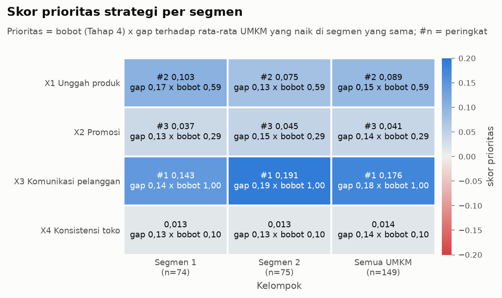
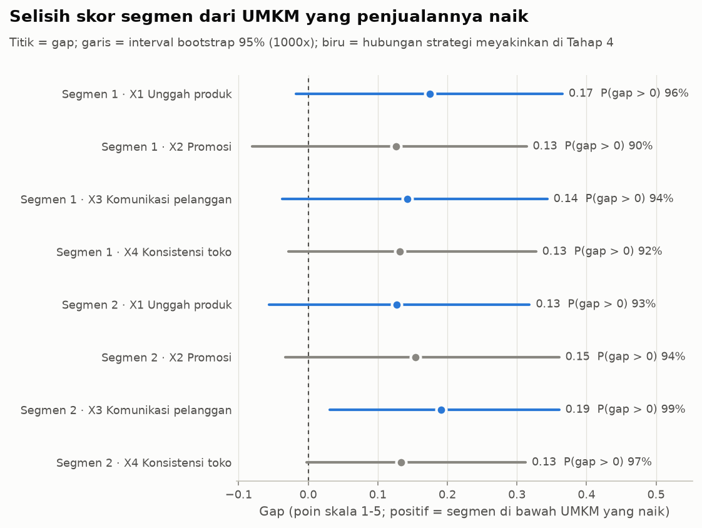

# Log Tahap 6: Rekomendasi Strategi

Dibuat oleh `umkm.rekomendasi` pada 2026-10-30 15:54. 149 UMKM (116 sampel utama, 62 naik), seed 42.

## Pengaturan (D28)

- Benchmark_s(segmen) = rata-rata skor strategi s pada UMKM `naik_penjualan` = 1 di sampel utama segmen itu (D14); bila kurang dari 5 UMKM, benchmark seluruh UMKM yang naik.
- Skor_s(segmen) = rata-rata skor seluruh anggota segmen (149 UMKM, termasuk tanpa baseline; D27). gap = max(0, benchmark - skor); prioritas = bobot x gap; ambil 3 teratas dengan prioritas > 0.
- Rata-rata vs rata-rata (pilihan pengguna, 2026-10-30): rumus plan awal (median UMKM naik vs rata-rata segmen) mencampur dua ukuran dan, karena skor Likert menumpuk di angka bulat, hanya memberi 2 strategi berprioritas > 0 per segmen. Dihitung sebagai sensitivitas.
- Bobot dari Tahap 4 (D26), sama untuk semua segmen. Penyajian: satu urutan umum + penyesuaian tindakan per segmen (pilihan pengguna, 2026-10-30).
- Butir fokus: 2 butir kuesioner dengan gap terbesar per strategi; penyesuaian tindakan dipilih dari kondisi usaha segmen (pusat skala omzet di bawah rata-rata = 'kecil', selain itu 'besar').
- Bootstrap 1000x (baris di dalam tiap kelompok, bobot tetap). Simulasi: skor satu strategi +1 poin (maks 5) pada model terbaik Tahap 4 (random_forest, AUC CV tertinggi) yang dilatih pada sampel utama; logistik sebagai pembanding.

## Bobot strategi (Tahap 4)

| strategi | nama | bobot | pengaruh | n_koef | p_koef_positif | meyakinkan | or_logit | p_logit | peringkat |
|---|---|---|---|---|---|---|---|---|---|
| x1_unggah | X1 Unggah produk | 0.590 | 0.591 | 0.860 | 0.998 | ya | 2.194 | 0.005 | 2 |
| x2_promosi | X2 Promosi | 0.295 | 0.357 | 0.249 | 0.826 | TIDAK | 1.255 | 0.344 | 3 |
| x3_komunikasi | X3 Komunikasi pelanggan | 1.000 | 1.000 | 1.000 | 1.000 | ya | 2.493 | 0.001 | 1 |
| x4_konsistensi | X4 Konsistensi toko | 0.100 | 0.000 | 0.000 | 0.369 | TIDAK | 0.927 | 0.777 | 4 |

## Skor, benchmark, gap, prioritas

| segmen | strategi | skor | benchmark | gap | gap_ci_bawah | gap_ci_atas | p_gap_positif | bobot | prioritas | peringkat | p_peringkat_1 | p_tiga_besar |
|---|---|---|---|---|---|---|---|---|---|---|---|---|
| 1 | X1 | 2.334 | 2.509 | 0.175 | -0.018 | 0.365 | 0.962 | 0.590 | 0.103 | 2 | 0.350 | 0.954 |
| 1 | X2 | 2.392 | 2.519 | 0.127 | -0.081 | 0.314 | 0.898 | 0.295 | 0.037 | 3 | 0.004 | 0.819 |
| 1 | X3 | 3.465 | 3.607 | 0.143 | -0.037 | 0.344 | 0.935 | 1.000 | 0.143 | 1 | 0.646 | 0.922 |
| 1 | X4 | 3.105 | 3.237 | 0.132 | -0.028 | 0.327 | 0.925 | 0.100 | 0.013 | 0 | 0.000 | 0.262 |
| 2 | X1 | 2.387 | 2.514 | 0.128 | -0.056 | 0.318 | 0.934 | 0.590 | 0.075 | 2 | 0.118 | 0.899 |
| 2 | X2 | 2.360 | 2.514 | 0.154 | -0.033 | 0.361 | 0.943 | 0.295 | 0.045 | 3 | 0.004 | 0.888 |
| 2 | X3 | 3.557 | 3.749 | 0.191 | 0.031 | 0.361 | 0.994 | 1.000 | 0.191 | 1 | 0.878 | 0.990 |
| 2 | X4 | 3.267 | 3.400 | 0.133 | -0.003 | 0.312 | 0.974 | 0.100 | 0.013 | 0 | 0.000 | 0.191 |
| Semua | X1 | 2.361 | 2.512 | 0.151 | 0.022 | 0.276 | 0.986 | 0.590 | 0.089 | 2 | 0.126 | 0.981 |
| Semua | X2 | 2.376 | 2.516 | 0.140 | -0.003 | 0.286 | 0.969 | 0.295 | 0.041 | 3 | 0.000 | 0.908 |
| Semua | X3 | 3.511 | 3.687 | 0.176 | 0.058 | 0.296 | 0.999 | 1.000 | 0.176 | 1 | 0.874 | 0.997 |
| Semua | X4 | 3.187 | 3.329 | 0.142 | 0.026 | 0.265 | 0.992 | 0.100 | 0.014 | 0 | 0.000 | 0.106 |

`gap` sudah dipotong di 0; `gap_ci_*` = interval bootstrap 95% dari selisih mentah. `p_tiga_besar` = peluang bootstrap strategi masuk tiga prioritas teratas.

**Interpretasi:** Urutan prioritas sama di semua segmen dan seluruh UMKM (X3 > X1 > X2). X3 Komunikasi pelanggan mendapat skor prioritas tertinggi (0,143 dan 0,191) terutama karena bobotnya paling besar (1,00); gap keempat strategi hampir sama (0,13-0,19 poin).

**Interpretasi:** Semua gap positif (skor segmen sedikit di bawah UMKM yang penjualannya naik), tetapi kecil (0,13-0,19 poin pada skala 1-5); interval bootstrap 7 dari 8 gap mencakup nol, hanya X3 di segmen 2 yang seluruhnya di atas nol.

## Butir fokus per segmen

| segmen | strategi | butir | tindakan | skor | benchmark | gap |
|---|---|---|---|---|---|---|
| 1 | x1_unggah | x1_unggah_3 | mengunggah ulang produk lama agar tetap terlihat pembeli | 2.35 | 2.56 | 0.20 |
| 1 | x1_unggah | x1_unggah_4 | memantau produk yang sepi dan perlu diunggah ulang | 2.39 | 2.59 | 0.20 |
| 1 | x2_promosi | x2_promosi_3 | memanfaatkan fitur promosi bawaan marketplace | 2.45 | 2.59 | 0.15 |
| 1 | x2_promosi | x2_promosi_4 | mengevaluasi hasil tiap promosi (pesanan sebelum vs selama promo) | 2.43 | 2.63 | 0.20 |
| 1 | x3_komunikasi | x3_komunikasi_1 | membalas chat pelanggan dengan cepat | 3.41 | 3.56 | 0.15 |
| 1 | x3_komunikasi | x3_komunikasi_5 | menjaga komunikasi sampai pesanan diterima pelanggan | 3.46 | 3.63 | 0.17 |
| 1 | x4_konsistensi | x4_konsistensi_1 | menjaga toko tetap aktif dan terkelola | 3.08 | 3.22 | 0.14 |
| 1 | x4_konsistensi | x4_konsistensi_5 | tetap mengelola toko saat sedang sibuk | 3.14 | 3.33 | 0.20 |
| 2 | x1_unggah | x1_unggah_1 | menjadwalkan unggah produk rutin setiap minggu | 2.44 | 2.57 | 0.13 |
| 2 | x1_unggah | x1_unggah_3 | mengunggah ulang produk lama agar tetap terlihat pembeli | 2.32 | 2.49 | 0.17 |
| 2 | x2_promosi | x2_promosi_3 | memanfaatkan fitur promosi bawaan marketplace | 2.36 | 2.57 | 0.21 |
| 2 | x2_promosi | x2_promosi_4 | mengevaluasi hasil tiap promosi (pesanan sebelum vs selama promo) | 2.33 | 2.51 | 0.18 |
| 2 | x3_komunikasi | x3_komunikasi_1 | membalas chat pelanggan dengan cepat | 3.52 | 3.74 | 0.22 |
| 2 | x3_komunikasi | x3_komunikasi_4 | menanggapi keluhan atau komplain pelanggan segera | 3.60 | 3.83 | 0.23 |
| 2 | x4_konsistensi | x4_konsistensi_2 | memperbarui stok produk secara rutin | 3.23 | 3.40 | 0.17 |
| 2 | x4_konsistensi | x4_konsistensi_5 | tetap mengelola toko saat sedang sibuk | 3.23 | 3.37 | 0.14 |
| Semua | x1_unggah | x1_unggah_3 | mengunggah ulang produk lama agar tetap terlihat pembeli | 2.34 | 2.52 | 0.18 |
| Semua | x1_unggah | x1_unggah_4 | memantau produk yang sepi dan perlu diunggah ulang | 2.40 | 2.56 | 0.16 |
| Semua | x2_promosi | x2_promosi_3 | memanfaatkan fitur promosi bawaan marketplace | 2.40 | 2.58 | 0.18 |
| Semua | x2_promosi | x2_promosi_4 | mengevaluasi hasil tiap promosi (pesanan sebelum vs selama promo) | 2.38 | 2.56 | 0.18 |
| Semua | x3_komunikasi | x3_komunikasi_1 | membalas chat pelanggan dengan cepat | 3.46 | 3.66 | 0.20 |
| Semua | x3_komunikasi | x3_komunikasi_4 | menanggapi keluhan atau komplain pelanggan segera | 3.55 | 3.74 | 0.19 |
| Semua | x4_konsistensi | x4_konsistensi_2 | memperbarui stok produk secara rutin | 3.13 | 3.29 | 0.16 |
| Semua | x4_konsistensi | x4_konsistensi_5 | tetap mengelola toko saat sedang sibuk | 3.18 | 3.35 | 0.17 |

Tabel semua butir: `tables/rekomendasi_butir.csv`.

## Sensitivitas urutan prioritas

| keterangan | segmen | n | n_naik | urutan | n_prioritas | sama_dengan_utama | rho_vs_utama | prioritas_X1 | prioritas_X2 | prioritas_X3 | prioritas_X4 |
|---|---|---|---|---|---|---|---|---|---|---|---|
| rata-rata vs rata-rata, bobot D26 (utama) | 1 | 74 | 27 | X3 > X1 > X2 | 3 | ya | 1.000 | 0.103 | 0.037 | 0.143 | 0.013 |
| rata-rata vs rata-rata, bobot D26 (utama) | 2 | 75 | 35 | X3 > X1 > X2 | 3 | ya | 1.000 | 0.075 | 0.045 | 0.191 | 0.013 |
| rata-rata vs rata-rata, bobot D26 (utama) | Semua | 149 | 62 | X3 > X1 > X2 | 3 | ya | 1.000 | 0.089 | 0.041 | 0.176 | 0.014 |
| bobot sama rata (1 untuk semua strategi) | 1 | 74 | 27 | X1 > X3 > X4 | 3 | TIDAK | 0.600 | 0.175 | 0.127 | 0.143 | 0.132 |
| bobot sama rata (1 untuk semua strategi) | 2 | 75 | 35 | X3 > X2 > X4 | 3 | TIDAK | 0.400 | 0.128 | 0.154 | 0.191 | 0.133 |
| bobot sama rata (1 untuk semua strategi) | Semua | 149 | 62 | X3 > X1 > X4 | 3 | TIDAK | 0.800 | 0.151 | 0.140 | 0.176 | 0.142 |
| bobot dari koefisien logit saja | 1 | 74 | 27 | X1 > X3 > X2 | 3 | TIDAK | 0.800 | 0.150 | 0.032 | 0.143 | 0.013 |
| bobot dari koefisien logit saja | 2 | 75 | 35 | X3 > X1 > X2 | 3 | ya | 1.000 | 0.110 | 0.038 | 0.191 | 0.013 |
| bobot dari koefisien logit saja | Semua | 149 | 62 | X3 > X1 > X2 | 3 | ya | 1.000 | 0.130 | 0.035 | 0.176 | 0.014 |
| skor segmen hanya dari sampel utama | 1 | 74 | 27 | X3 > X1 > X2 | 3 | ya | 1.000 | 0.112 | 0.049 | 0.144 | 0.007 |
| skor segmen hanya dari sampel utama | 2 | 75 | 35 | X3 > X1 > X2 | 3 | ya | 1.000 | 0.094 | 0.053 | 0.227 | 0.014 |
| skor segmen hanya dari sampel utama | Semua | 149 | 62 | X3 > X1 > X2 | 3 | ya | 1.000 | 0.101 | 0.052 | 0.189 | 0.011 |
| tanpa jawaban seragam (D20) | 1 | 68 | 22 | X3 > X1 > X2 | 3 | ya | 1.000 | 0.072 | 0.021 | 0.240 | 0.018 |
| tanpa jawaban seragam (D20) | 2 | 71 | 32 | X3 > X1 > X2 | 3 | ya | 1.000 | 0.059 | 0.038 | 0.213 | 0.014 |
| tanpa jawaban seragam (D20) | Semua | 139 | 54 | X3 > X1 > X2 | 3 | ya | 1.000 | 0.067 | 0.030 | 0.229 | 0.017 |
| median UMKM naik vs median segmen | 1 | 74 | 27 | X3 > X1 > X2 | 3 | ya | 1.000 | 0.147 | 0.074 | 0.400 | 0.000 |
| median UMKM naik vs median segmen | 2 | 75 | 35 | X3 > X2 | 2 | TIDAK | 0.632 | 0.000 | 0.147 | 0.400 | 0.000 |
| median UMKM naik vs median segmen | Semua | 149 | 62 | X3 > X1 > X2 | 3 | ya | 1.000 | 0.147 | 0.074 | 0.500 | 0.000 |
| median UMKM naik vs rata-rata segmen (rumus plan awal) | 1 | 74 | 27 | X3 > X2 | 2 | TIDAK | 0.632 | 0.000 | 0.106 | 0.135 | 0.000 |
| median UMKM naik vs rata-rata segmen (rumus plan awal) | 2 | 75 | 35 | X3 > X2 | 2 | TIDAK | 0.632 | 0.000 | 0.115 | 0.243 | 0.000 |
| median UMKM naik vs rata-rata segmen (rumus plan awal) | Semua | 149 | 62 | X3 > X2 | 2 | TIDAK | 0.632 | 0.000 | 0.110 | 0.189 | 0.000 |
| benchmark dari semua UMKM naik (tanpa segmen) | 1 | 74 | 27 | X3 > X1 > X2 | 3 | ya | 1.000 | 0.105 | 0.037 | 0.222 | 0.022 |
| benchmark dari semua UMKM naik (tanpa segmen) | 2 | 75 | 35 | X3 > X1 > X2 | 3 | ya | 1.000 | 0.074 | 0.046 | 0.130 | 0.006 |
| benchmark dari semua UMKM naik (tanpa segmen) | Semua | 149 | 62 | X3 > X1 > X2 | 3 | ya | 1.000 | 0.089 | 0.041 | 0.176 | 0.014 |

## Simulasi +1 poin (ilustrasi model)

| segmen | model | strategi | n | peluang_dasar_persen | selisih_pp | persen_skor_sudah_5 |
|---|---|---|---|---|---|---|
| 1 | logistik | X1 | 47 | 56.01 | 19.13 | 0.00 |
| 1 | logistik | X2 | 47 | 56.01 | 5.80 | 0.00 |
| 1 | logistik | X3 | 47 | 56.01 | 21.70 | 0.06 |
| 1 | logistik | X4 | 47 | 56.01 | -1.12 | 0.00 |
| 1 | random_forest | X1 | 47 | 56.28 | 7.49 | 0.00 |
| 1 | random_forest | X2 | 47 | 56.28 | 6.52 | 0.00 |
| 1 | random_forest | X3 | 47 | 56.28 | 14.36 | 0.06 |
| 1 | random_forest | X4 | 47 | 56.28 | -0.36 | 0.00 |
| 2 | logistik | X1 | 69 | 51.71 | 20.22 | 0.00 |
| 2 | logistik | X2 | 69 | 51.71 | 6.04 | 0.00 |
| 2 | logistik | X3 | 69 | 51.71 | 22.58 | 0.06 |
| 2 | logistik | X4 | 69 | 51.71 | -1.15 | 0.00 |
| 2 | random_forest | X1 | 69 | 50.75 | 8.52 | 0.00 |
| 2 | random_forest | X2 | 69 | 50.75 | 6.80 | 0.00 |
| 2 | random_forest | X3 | 69 | 50.75 | 17.51 | 0.06 |
| 2 | random_forest | X4 | 69 | 50.75 | -0.22 | 0.00 |
| Semua | logistik | X1 | 116 | 53.45 | 19.78 | 0.00 |
| Semua | logistik | X2 | 116 | 53.45 | 5.95 | 0.00 |
| Semua | logistik | X3 | 116 | 53.45 | 22.22 | 0.06 |
| Semua | logistik | X4 | 116 | 53.45 | -1.14 | 0.00 |
| Semua | random_forest | X1 | 116 | 52.99 | 8.10 | 0.00 |
| Semua | random_forest | X2 | 116 | 52.99 | 6.69 | 0.00 |
| Semua | random_forest | X3 | 116 | 52.99 | 16.23 | 0.06 |
| Semua | random_forest | X4 | 116 | 52.99 | -0.28 | 0.00 |

`selisih_pp` = rata-rata selisih peluang prediksi naik_penjualan (poin persen) bila satu skor strategi dinaikkan, profil dan strategi lain tetap. Dilatih dan dievaluasi pada data yang sama (in-sample); bukan perkiraan dampak.

## Tabel rekomendasi

| segmen | peringkat | nama_strategi | skor_segmen | benchmark | gap | bobot | prioritas | p_tiga_besar | selisih_prediksi_plus1_pp | fokus_butir |
|---|---|---|---|---|---|---|---|---|---|---|
| 1 | 1 | X3 Komunikasi pelanggan | 3.465 | 3.607 | 0.143 | 1.000 | 0.143 | 0.922 | 14.363 | x3_komunikasi_5; x3_komunikasi_1 |
| 1 | 2 | X1 Unggah produk | 2.334 | 2.509 | 0.175 | 0.590 | 0.103 | 0.954 | 7.485 | x1_unggah_3; x1_unggah_4 |
| 1 | 3 | X2 Promosi | 2.392 | 2.519 | 0.127 | 0.295 | 0.037 | 0.819 | 6.524 | x2_promosi_4; x2_promosi_3 |
| 2 | 1 | X3 Komunikasi pelanggan | 3.557 | 3.749 | 0.191 | 1.000 | 0.191 | 0.990 | 17.505 | x3_komunikasi_4; x3_komunikasi_1 |
| 2 | 2 | X1 Unggah produk | 2.387 | 2.514 | 0.128 | 0.590 | 0.075 | 0.899 | 8.524 | x1_unggah_3; x1_unggah_1 |
| 2 | 3 | X2 Promosi | 2.360 | 2.514 | 0.154 | 0.295 | 0.045 | 0.888 | 6.804 | x2_promosi_3; x2_promosi_4 |
| Semua | 1 | X3 Komunikasi pelanggan | 3.511 | 3.687 | 0.176 | 1.000 | 0.176 | 0.997 | 16.232 | x3_komunikasi_1; x3_komunikasi_4 |
| Semua | 2 | X1 Unggah produk | 2.361 | 2.512 | 0.151 | 0.590 | 0.089 | 0.981 | 8.103 | x1_unggah_3; x1_unggah_4 |
| Semua | 3 | X2 Promosi | 2.376 | 2.516 | 0.140 | 0.295 | 0.041 | 0.908 | 6.691 | x2_promosi_4; x2_promosi_3 |

Alasan dan tindakan lengkap: `tables/rekomendasi_per_segmen.csv`.

## Artefak inferensi

- `models/v1/segmen.joblib`
- `models/v1/model.joblib`
- `models/v1/benchmark_per_segmen.json`
- `models/v1/pengaruh_strategi.json`
- `models/v1/model_meta.json`

## Pengecekan: recommend() vs tabel

| segmen | segmen_recommend | urutan_tabel | urutan_recommend | selisih_prioritas_maks | cocok |
|---|---|---|---|---|---|
| 1 | 1 | X3 > X1 > X2 | X3 > X1 > X2 | 0.000043 | ya |
| 2 | 2 | X3 > X1 > X2 | X3 > X1 > X2 | 0.000038 | ya |

Profil wakil = median profil segmen + rata-rata skor strategi segmen, dijalankan lewat `recommend()` yang hanya memuat artefak `models/` (tanpa data survei).

## Tiga contoh masukan

- `contoh_A_kecil_baru`: segmen 1, prioritas X3 > X1 > X2.
- `contoh_B_besar_mapan`: segmen 2, prioritas X3 > X2.
- `contoh_C_sketsa_kontrak`: segmen 2, prioritas X1 > X4 > X2.

Masukan dan keluaran lengkap: `integration_contract.md`.

## Keterbatasan

- Gap kecil (0,13-0,19 poin pada skala 1-5) dan interval bootstrap 7 dari 8 gap segmen mencakup nol. Arahnya konsisten (peluang gap > 0: 90%-99%), tetapi beda skor UMKM yang naik dan rata-rata segmen tidak besar.
- Karena gap keempat strategi hampir sama, urutan prioritas terutama ditentukan oleh bobot Tahap 4. Urutan utama bertahan di 4 dari 8 varian sensitivitas; berubah pada bobot sama rata (1 untuk semua strategi), bobot dari koefisien logit saja, median UMKM naik vs median segmen dan median UMKM naik vs rata-rata segmen (rumus plan awal). X3 tetap teratas di 14 dari 16 kombinasi varian x segmen.
- Benchmark = UMKM yang melaporkan kenaikan penjualan. Di sampel utama pembandingnya adalah UMKM yang menulis angka omzet dan transaksi sama persis (D26), bukan UMKM yang turun.
- Kedua segmen tidak berbeda bermakna pada skor strategi maupun kinerja (Tahap 5), sehingga perbedaan rekomendasi antar-segmen hanya pada penyesuaian tindakan. Teks penyesuaian adalah templat yang disusun dari kondisi usaha segmen, bukan hasil uji data.
- Butir fokus dipilih dari selisih butir yang kecil dan mirip (0,07-0,23 poin); urutan butir hanya panduan, bukan temuan yang kuat.
- Simulasi +1 poin memakai model random_forest (AUC CV 0,73) yang dilatih pada seluruh sampel utama; ini menggambarkan pola yang dipelajari model, bukan perkiraan dampak bila UMKM mengubah strateginya.
- Benchmark segmen bertumpu pada 27 UMKM naik di segmen 1 dan 35 UMKM naik di segmen 2; seluruh data adalah survei satu waktu dari 149 UMKM (isian sendiri).
- Untuk UMKM baru, segmen ditentukan dari profil usaha; struktur segmen lemah (silhouette Tahap 5 sekitar 0,25), sehingga UMKM di dekat batas bisa masuk segmen mana pun. Omzet masukan dibandingkan dengan kuartil omzet sebelum marketplace di data latih.
