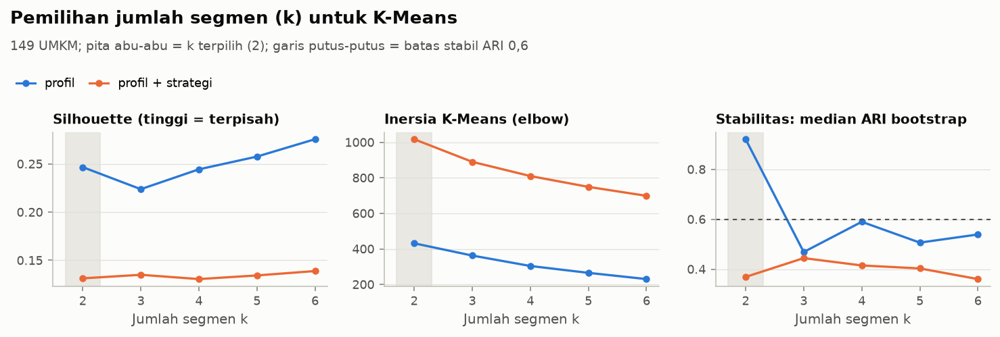
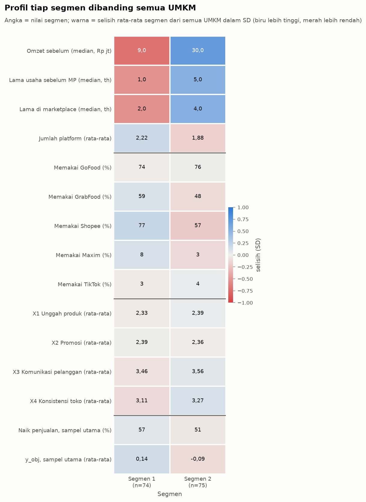
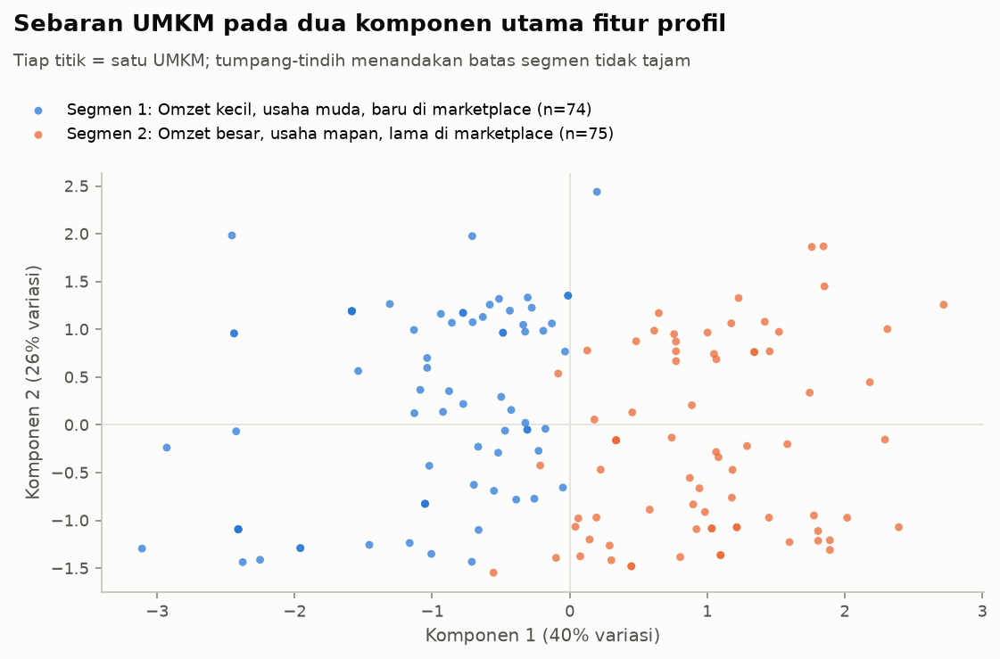

# Log Tahap 5: Segmentasi Kondisi UMKM

Dibuat oleh `umkm.segmentation` pada 2026-10-30 11:56. 149 UMKM, seed 42.

## Pengaturan (D27)

- Fitur pembentuk segmen (profil saja): `skala_omzet_ord`, `lama_usaha_pra_mp`, `lama_di_mp`, `jumlah_platform`; `lama_usaha_pra_mp`, `lama_di_mp` ditransformasi log1p; semua distandarkan (StandardScaler di dalam pipa).
- `skala_omzet_ord` = kuartil skala omzet (1 = Q1_kecil ... 4 = Q4_besar, D22), dipakai sebagai angka agar omzet 0 (R008) dan omzet sangat besar tidak mendominasi jarak.
- Skor X1-X4 dan target kinerja TIDAK dipakai membentuk segmen; set profil + X1-X4 dihitung sebagai pembanding.
- K-Means k = 2..6 (n_init 50); pembanding Ward dan Gaussian Mixture (kovarians penuh, n_init 10) pada data terstandar.
- Aturan k: semua klaster >= 15 UMKM DAN median ARI bootstrap >= 0,6, lalu silhouette tertinggi. Stabilitas: bootstrap 100x, pipa dilatih ulang di sampel bootstrap lalu memprediksi seluruh baris; ARI terhadap solusi utama dan Jaccard maksimum per klaster (Hennig, 2007).
- Nomor segmen diurutkan dari rata-rata pusat terstandar terendah (segmen 1 = paling kecil/baru). Nama dari fitur yang |z| rata-rata segmennya > 0,25.

## Pemilihan k

| set_fitur | k | ukuran | silhouette | inersia | calinski_harabasz | davies_bouldin | ari_boot_median | ari_boot_p05 | ari_ward | ari_gmm |
|---|---|---|---|---|---|---|---|---|---|---|
| profil | 2 | 75/74 | 0.247 | 431.316 | 56.127 | 1.550 | 0.921 | 0.748 | 0.513 | 0.420 |
| profil | 3 | 50/50/49 | 0.224 | 362.416 | 47.050 | 1.446 | 0.469 | 0.234 | 0.246 | 0.326 |
| profil | 4 | 43/42/35/29 | 0.244 | 303.716 | 46.514 | 1.379 | 0.590 | 0.305 | 0.402 | 0.329 |
| profil | 5 | 43/36/26/22/22 | 0.258 | 265.099 | 44.936 | 1.293 | 0.506 | 0.386 | 0.603 | 0.276 |
| profil | 6 | 32/31/28/24/17/17 | 0.276 | 230.048 | 45.496 | 1.190 | 0.539 | 0.344 | 0.347 | 0.265 |
| profil + strategi | 2 | 77/72 | 0.131 | 1017.050 | 25.286 | 2.302 | 0.369 | 0.006 | 0.438 | 0.017 |
| profil + strategi | 3 | 60/50/39 | 0.135 | 889.849 | 24.787 | 1.964 | 0.444 | 0.166 | 0.307 | 0.156 |
| profil + strategi | 4 | 44/43/31/31 | 0.131 | 809.823 | 22.810 | 1.835 | 0.415 | 0.212 | 0.238 | 0.117 |
| profil + strategi | 5 | 38/37/32/27/15 | 0.134 | 748.916 | 21.299 | 1.779 | 0.403 | 0.217 | 0.255 | 0.161 |
| profil + strategi | 6 | 39/38/33/15/15/9 | 0.139 | 698.544 | 20.203 | 1.716 | 0.360 | 0.235 | 0.359 | 0.194 |

Terpilih k = 2 (aturan: stabil); silhouette 0,247 (sangat lemah). Set profil + strategi: tidak ada k yang stabil; dengan aturan cadangan k = 3 (silhouette 0,135), ARI terhadap segmen utama 0,52.

**Interpretasi:** Dengan fitur profil, k = 2 adalah satu-satunya pilihan yang stabil (median ARI bootstrap 0,92, k lain 0,47-0,59) dengan silhouette 0,25; menambah skor X1-X4 ke fitur menurunkan silhouette ke 0,13-0,14 dan stabilitas ke 0,36-0,44, dan inersia turun landai tanpa siku yang jelas.

## Stabilitas

ARI bootstrap solusi utama: median 0,921, persentil 5 0,748, minimum 0,321 (100 ulangan).

| segmen | nama_segmen | jaccard_rata | jaccard_median | jaccard_p05 | persen_bubar | label |
|---|---|---|---|---|---|---|
| 1 | Omzet kecil, usaha muda, baru di marketplace | 0.945 | 0.961 | 0.878 | 0.000 | sangat stabil |
| 2 | Omzet besar, usaha mapan, lama di marketplace | 0.946 | 0.961 | 0.868 | 0.000 | sangat stabil |

### Sensitivitas pilihan fitur dan sampel

| varian | k | n_latih | ari_vs_utama | silhouette |
|---|---|---|---|---|
| fit hanya sampel utama (116) | 2 | 116 | 0.771 | 0.243 |
| tanpa transformasi log1p | 2 | 149 | 0.725 | 0.256 |
| profil + strategi (X1-X4) | 2 | 149 | 0.321 | 0.131 |

ARI terhadap segmen utama; varian dilatih ulang lalu memprediksi seluruh 149 UMKM. Menambah X1-X4 mengubah pengelompokan paling banyak, karena segmen lalu ikut dibentuk oleh tingkat strategi.

## Profil segmen

| segmen | nama_segmen | n | n_sampel_utama | n_tanpa_baseline | omzet_sebelum_median | lama_usaha_pra_mp_median | lama_di_mp_median | jumlah_platform_rata | x1_unggah_rata | x2_promosi_rata | x3_komunikasi_rata | x4_konsistensi_rata | n_naik_utama | persen_naik_utama | y_obj_rata_utama |
|---|---|---|---|---|---|---|---|---|---|---|---|---|---|---|---|
| 1 | Omzet kecil, usaha muda, baru di marketplace | 74 | 47 | 27 | 9000000.00 | 1.00 | 2.00 | 2.22 | 2.33 | 2.39 | 3.46 | 3.11 | 27 | 0.57 | 0.14 |
| 2 | Omzet besar, usaha mapan, lama di marketplace | 75 | 69 | 6 | 30000000.00 | 5.00 | 4.00 | 1.88 | 2.39 | 2.36 | 3.56 | 3.27 | 35 | 0.51 | -0.09 |
| Semua | Semua UMKM | 149 | 116 | 33 | 18000000.00 | 3.00 | 3.00 | 2.05 | 2.36 | 2.38 | 3.51 | 3.19 | 62 | 0.53 | -0.00 |

Tabel lengkap (platform, sebaran kuartil omzet, median strategi): `tables/profil_segmen.csv`.

**Interpretasi:** Segmen dibedakan terutama oleh skala omzet, lama usaha sebelum MP dan lama di marketplace (warna pekat di baris profil), sedangkan skor strategi dan kinerja nyaris sama antar-segmen (warna pucat; proporsi naik penjualan 57% dan 51%; tidak ada beda bermakna setelah koreksi Holm).

### Muatan komponen utama (PCA, data terstandar)

| fitur | PC1 | PC2 |
|---|---|---|
| skala_omzet_ord | 0.508 | -0.221 |
| lama_usaha_pra_mp | 0.607 | 0.041 |
| lama_di_mp | 0.611 | 0.166 |
| jumlah_platform | -0.014 | 0.960 |

**Interpretasi:** Dua komponen utama menjelaskan 65% variasi fitur profil; komponen 1 terutama memuat skala omzet, lama usaha sebelum MP dan lama di marketplace. Titik-titik segmen bersinggungan di bagian tengah, sesuai silhouette yang rendah: segmen lebih tepat dibaca sebagai ujung-ujung rentang kondisi usaha daripada kelompok yang terpisah tegas.

## Beda antar-segmen pada variabel di luar fitur pembentuk

| variabel | keluarga | sampel | uji | n | statistik | p | efek | ukuran_efek | p_holm |
|---|---|---|---|---|---|---|---|---|---|
| x1_unggah | strategi | semua | Kruskal-Wallis | 149 | 0.406 | 0.524 | 0.003 | epsilon-kuadrat | 1.000 |
| x2_promosi | strategi | semua | Kruskal-Wallis | 149 | 0.219 | 0.640 | 0.001 | epsilon-kuadrat | 1.000 |
| x3_komunikasi | strategi | semua | Kruskal-Wallis | 149 | 0.498 | 0.481 | 0.003 | epsilon-kuadrat | 1.000 |
| x4_konsistensi | strategi | semua | Kruskal-Wallis | 149 | 2.893 | 0.089 | 0.020 | epsilon-kuadrat | 0.356 |
| y_persepsi | persepsi | semua | Kruskal-Wallis | 149 | 3.412 | 0.065 | 0.023 | epsilon-kuadrat | 0.065 |
| y_obj | kinerja | utama | Kruskal-Wallis | 116 | 1.514 | 0.218 | 0.013 | epsilon-kuadrat | 0.437 |
| y_pelanggan_baru | kinerja | utama | Kruskal-Wallis | 116 | 2.248 | 0.134 | 0.020 | epsilon-kuadrat | 0.401 |
| naik_penjualan | kinerja | utama | Fisher | 116 | 0.508 | 0.570 | 0.066 | Cramer V | 0.570 |

Fitur profil tidak diuji karena pasti berbeda (segmen dibentuk darinya). Holm per keluarga (strategi; kinerja; persepsi diuji terpisah). Efek epsilon-kuadrat < 0,01 sangat kecil, 0,01-0,06 kecil.

## Deskripsi segmen

**Segmen 1: Omzet kecil, usaha muda, baru di marketplace** berisi 74 UMKM (50%). Median omzet sebelum marketplace Rp9,0 jt (kuartil Rp5,2 jt sampai Rp15,0 jt); kuartil omzet terbanyak Q1 (53%). Median lama usaha sebelum masuk marketplace 1,0 tahun dan lama di marketplace 2,0 tahun; 27 UMKM (36%) berdiri bersamaan dengan masuk marketplace (tanpa baseline). Rata-rata memakai 2,22 platform (30% hanya satu); platform terbanyak Shopee 77%, GoFood 74% dan GrabFood 59%. Skor strategi rata-rata: X1 2,33, X2 2,39, X3 3,46, X4 3,11. Di sampel utama (47 UMKM), 57% (27 UMKM) melaporkan kenaikan penjualan, rata-rata y_obj 0,14. Keanggotaan segmen ini sangat stabil saat data di-bootstrap (Jaccard rata-rata 0,94).

**Segmen 2: Omzet besar, usaha mapan, lama di marketplace** berisi 75 UMKM (50%). Median omzet sebelum marketplace Rp30,0 jt (kuartil Rp20,5 jt sampai Rp60,0 jt); kuartil omzet terbanyak Q4 (45%). Median lama usaha sebelum masuk marketplace 5,0 tahun dan lama di marketplace 4,0 tahun; 6 UMKM (8%) berdiri bersamaan dengan masuk marketplace (tanpa baseline). Rata-rata memakai 1,88 platform (47% hanya satu); platform terbanyak GoFood 76%, Shopee 57% dan GrabFood 48%. Skor strategi rata-rata: X1 2,39, X2 2,36, X3 3,56, X4 3,27. Di sampel utama (69 UMKM), 51% (35 UMKM) melaporkan kenaikan penjualan, rata-rata y_obj -0,09. Keanggotaan segmen ini sangat stabil saat data di-bootstrap (Jaccard rata-rata 0,95).

## Keterbatasan

- Struktur klaster sangat lemah (silhouette 0,247): UMKM tersebar kontinu, bukan kelompok yang terpisah tegas. Segmen berguna sebagai ringkasan ujung-ujung kondisi usaha; UMKM di dekat batas bisa masuk segmen mana pun.
- Ward dan Gaussian Mixture hanya sebagian sepakat dengan K-Means pada k = 2 (ARI 0,51 dan 0,42), jadi batas segmen bergantung pada metode.
- Segmen tidak berbeda bermakna pada X1 unggah produk, X2 promosi, X3 komunikasi pelanggan, X4 konsistensi toko, persepsi kinerja, y_obj, pelanggan baru (log) dan proporsi naik penjualan (setelah Holm). Artinya segmentasi ini menggambarkan kondisi usaha, bukan kelompok kinerja; benchmark Tahap 6 per segmen kemungkinan mirip satu sama lain.
- Fitur hanya empat dan sebagian kasar (skala omzet = kuartil 1-4; lama usaha dalam tahun bulat; jumlah platform 1-4), sehingga banyak UMKM bernilai kembar.
- UMKM tanpa baseline (33) ikut membentuk segmen tetapi tidak ikut sampel kinerja; 27 di segmen 1 dan 6 di segmen 2, sehingga proporsi naik penjualan segmen dihitung dari sampel utama yang lebih kecil.
